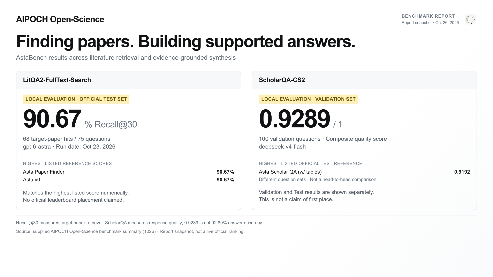
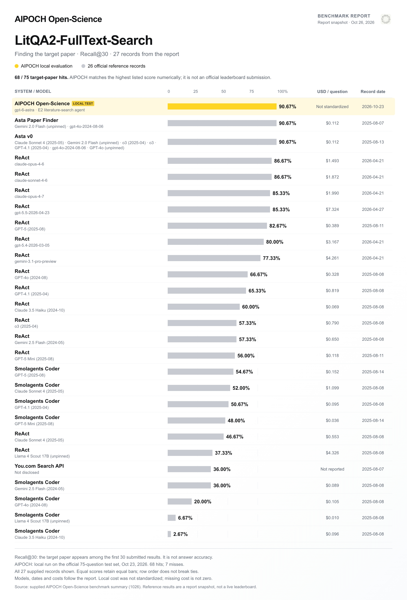
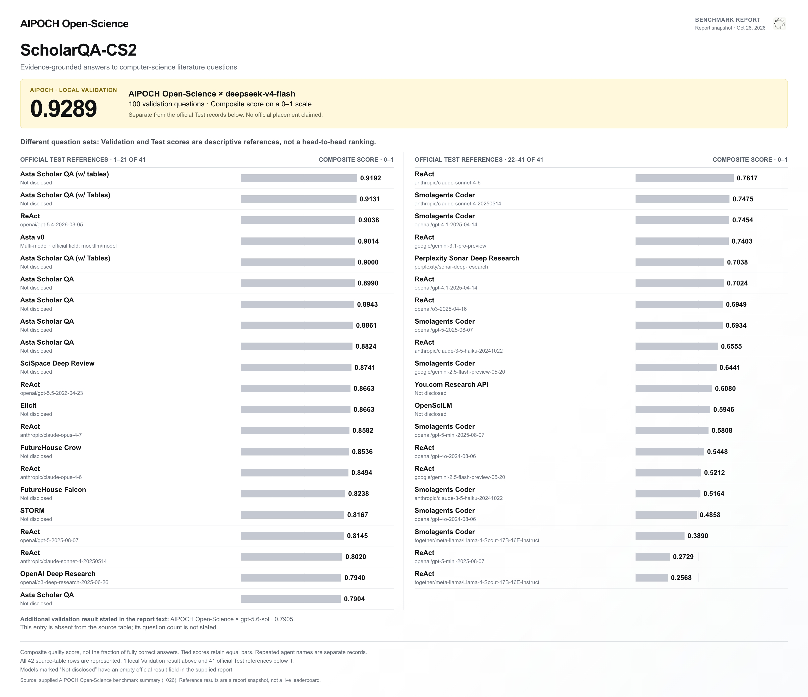

<h1 align="center">AIPOCH Open-Science</h1>

<p align="center">
  AI research workbench for reproducible science — open-source, local-first, and model-agnostic.
</p>

<p align="center">
  <a href="https://aipoch.com/open-science/download">
    
  </a>
  <a href="https://github.com/aipoch/open-science/releases/latest">
    
  </a>
  <a href="https://doi.org/10.5281/zenodo.22252246">
    
  </a>
  <a href="https://arxiv.org/abs/2610.17110">
    
  </a>
  <a href="#benchmark-performance">
    
  </a>
  <a href="https://github.com/aipoch/open-science/releases/latest">
    
  </a>
  <a href="LICENSE">
    
  </a>
  <a href="https://aipoch.com/open-science">
    
  </a>
</p>

<p align="center">
  <a href="./README.md"></a>
  <a href="./docs/zh-Hans/README.md"></a>
  <a href="./docs/zh-Hant/README.md"></a>
  <a href="./docs/ja/README.md"></a>
  <a href="./docs/ko/README.md"></a>
  <a href="./docs/fr/README.md"></a>
  <a href="./docs/ru/README.md"></a>
  <a href="./docs/de/README.md"></a>
  <a href="./docs/es/README.md"></a>
</p>

AIPOCH Open-Science is an AI research workbench for scientists and researchers, developed by [AIPOCH](https://aipoch.com/open-science) with an open-source, local-first, model-agnostic approach. It enables reproducible, inspectable research with scientific AI agents, Python and R execution, scientific data connectors, and cross-platform support for macOS, Windows, and Linux. Create a project, describe your research goal in plain language, and let the agents read files, search the web, run code, query scientific data sources, and produce reports, tables, and figures with traceable provenance—all in one workspace.

AIPOCH Open-Science supports computational and data-intensive research across disciplines, including machine learning, statistics, life sciences, chemistry, materials science, physics and environmental science. It supports the research process from literature review and hypothesis development to code execution, data analysis, simulation, visualization, and the production of traceable research outputs.

Completed research sessions can also be exported as portable `.science` packages for review, handoff, and archiving, with selected conversation branches, file versions, Notebook records, and verification evidence.

> 💡 **[AIPOCH Open-Science v1.0.6 released](https://github.com/aipoch/open-science/releases/latest)** _(last updated October 2026)_. This patch imports references from local Zotero libraries into the literature library, reads PDFs in automatic reading order, makes Windows installation about a third faster while preserving co-located research data, and keeps artifacts publishable through long-running turns. It also fixes OpenCode session reliability, Windows startup with binary cookie stores, and Slurm job outcome recovery. See the [v1.0.6 release notes](release-notes/1.0.6/en.md) for full details.

<p align="center">
 
</p>

## Table of Contents

- [Quick Start](#-quick-start)
- [Product Tour](#product-tour)
- [AIPOCH Open-Science `.science` Research Packages](#aipoch-open-science-science-research-packages)
- [AIPOCH Open-Science Paper and Citation](#aipoch-open-science-paper-and-citation)
- [Benchmark Performance](#benchmark-performance)
- [Core Capabilities](#core-capabilities)
- [Model Providers](#model-providers)
- [Data, Permissions, and Trust](#data-permissions-and-trust)
- [Development & Packaging](#development--packaging)
- [Frequently Asked Questions](#frequently-asked-questions)
- [Contributors](#contributors)
- [Get Involved](#get-involved)
- [License](#license)
- [Star History](#star-history)

## 🚀 Quick Start

### 1. Download the app

Open the [official download page](https://aipoch.com/open-science/download) and choose the installer for your computer:

| Your computer                           | Choose                                     |
| --------------------------------------- | ------------------------------------------ |
| macOS 12+ — Apple Silicon (M1 or newer) | The macOS DMG for Apple Silicon / ARM64    |
| macOS 12+ — Intel                       | The macOS DMG for Intel / x64              |
| Windows x64                             | The Windows x64 installer (code-signed)    |
| Linux x64                               | The Linux x64 AppImage or Debian package   |
| Linux ARM64                             | The Linux ARM64 AppImage or Debian package |

Download from the [official download page](https://aipoch.com/open-science/download); see [download verification](SECURITY.md#verifying-your-download) if needed.

On macOS, you can also install with [Homebrew](https://brew.sh):

```bash
brew install --cask open-science
```

For the standalone CLI on macOS or Linux, use the separate [AIPOCH tap](https://github.com/aipoch/homebrew-tap):

```bash
brew install aipoch/tap/open-science
```

This Formula includes Node and runs without the desktop app; its release may differ from the desktop Cask. See the [standalone runtime guide](docs/standalone-runtime.md) for prerequisites and upgrades.

For the standalone CLI and Web UI, install the published [npm package](https://www.npmjs.com/package/@aipoch/open-science) with **Node.js 22.13.0 or later**:

```bash
npm install --global @aipoch/open-science
open-science start --no-open
open-science url
```

Open the printed URL to complete setup, or follow the [terminal setup guide](packages/open-science/CLI.md#first-run-setup-codex). npm supports macOS ARM64/x64, glibc Linux ARM64/x64 and Windows x64; the desktop app is not required. Keep npm optional dependencies enabled and review the [Linux prerequisites and upgrade instructions](docs/standalone-runtime.md#install-from-npm). The URL contains an authentication token; keep it private.

Windows reinstalls preserve research data. For a full cleanup, see the [data reset tool](scripts/windows-reset/README.md), which permanently deletes local data after confirmation.

### 2. Complete first-time setup

Follow the setup wizard: **Environment → Data location → Agent runtime → Model provider → Notebook runtime**.

Complete the required environment and agent-runtime checks and test your model connection. Python/R Notebook setup is optional; Notebook and data-location settings can be changed later.

<table>
  <tr>
    <td width="50%"></td>
    <td width="50%"></td>
  </tr>
  <tr>
    <td align="center"><sub>Host compatibility, storage, and network checks</sub></td>
    <td align="center"><sub>Provider, API Key, endpoint, and model validation</sub></td>
  </tr>
</table>

### 3. Start a research project

1. Click **New project**, open a session, and describe your research goal, inputs, and expected outputs.
2. Attach files, select a model and approval mode, then send the task. Use `@` to reference project files or `/` to choose a skill.
3. Review tool activity and any approval requests, preview the results, and check their available evidence in **Provenance**.

> Screenshots in this README illustrate the workflow. Labels, catalogs, and other interface details may differ from the version you install.

## Product Tour

### From a research request to a traceable result

Consider a representative bioinformatics task: reproduce a published differential-expression analysis, compare the regenerated results with the paper, and deliver the report, tables, and figures needed for review. The screenshots below are representative views from documented AIPOCH Open-Science workflows; they illustrate each stage rather than one continuous session.

#### 1. Define the research task and evidence

Describe the research question, source paper and datasets, required methods or thresholds, expected outputs, and acceptance criteria. Upload supporting files or reference an existing project artifact with `@`, so the agent starts from explicit inputs instead of hidden context.

<p align="center">
  
</p>

#### 2. Execute with inspectable scientific tools

The agent can combine scientific skills, permissioned research connectors, searches, file operations, and Python or R code in the shared Notebook. Generated figures can be reviewed beside the research summary, while the artifact record exposes captured producer code and execution evidence for inspection.

<p align="center">
  
</p>

#### 3. Review reports, tables, and figures in place

The final response summarizes what reproduced, what differed, and which limitations matter. Generated Markdown reports, CSV tables, images, and other research artifacts remain attached to the session and are collected in the project file library, where they can be previewed beside the conversation and reused in follow-up work.

<p align="center">
  
</p>

#### 4. Trace every artifact back to its evidence

Each generated artifact is stored as an immutable, checksummed version. Its **Provenance** view can expose the producing code and execution history, referenced inputs, observed environment inventory, producing conversation branch, and version-scoped Reviewer findings. Evidence that could not be verified is marked unavailable rather than inferred.

<p align="center">
  
</p>

## AIPOCH Open-Science `.science` Research Packages

Export a completed research session as a portable `.science` package for review, handoff, and archiving. Choose the conversation branches, file versions, Notebook records, and verification evidence to include, then import the package into another project or computer.

Export and import are available in the desktop app, local Web sessions, and the headless CLI. Remote Web sessions cannot read or write arbitrary local package paths.

**Export → transfer → inspect**

1. Export a completed session and choose the contents to include.
2. Move the `.science` file to a collaborator or another computer.
3. Import it into a project. The right-hand **Research replay** shows the recorded process; the left-hand conversation lets you ask about it and follow fixed step references.

Imported records remain read-only. Watching a replay does not execute code, call a model, or restore credentials. Your first question creates an associated writable discussion; use **Create a copy to continue research** to run follow-up experiments. Re-executing a result still requires a complete recipe, required inputs, and an available runtime.

Side Chat conversations, private reading bookmarks, and credentials are excluded; included files depend on export selection. Received verification records describe the sender’s checks, not a rerun on this computer. See the [`.science` package guide](https://aipoch.com/docs/guides/research-packages/).

## AIPOCH Open-Science Paper and Citation

**[AIPOCH Open-Science: An Open-Source AI Research Workbench with Reproducible .science Packages](https://arxiv.org/abs/2610.17110)**

arXiv preprint · [v1](https://arxiv.org/abs/2610.17110v1) · Submitted October 12, 2026.

Our preprint introduces AIPOCH Open-Science, an open-source AI research workbench with portable `.science` packages for sharing research context, artifact versions, and verification records. Read the paper for the package exchange design and controlled evaluation.

If you use AIPOCH Open-Science in your research, you can cite the preprint:

<details>
<summary>BibTeX citation</summary>

```bibtex
@misc{ouyang2026aipochopenscienceopensourceai,
      title={AIPOCH Open-Science: An Open-Source AI Research Workbench with Reproducible .science Packages},
      author={Wen Ouyang and Bocheng Huang and Qianyu Yao and Fei Sun and Minying Deng and Haoyue Cheng and Wenwen Zhou and Lei Mou and Yusi Wei and Jiang Li and Kun Zhu and Lei Wang and Yi Feng and Jiaheng Dai and Ke Qian and Dan Wang and Yahui Wang and Chenyi Wang and Mingsheng Lyu and Yaqiang Zhang and Ping Zheng and Chunhua Tang and Xinge Ma and Xu Zhang and Youjia Fan and Can Lu and Zhijun Dai and Man Hu and Qiqi Xie and Beinan Liu and Yuanning Guo and Yunze Liu and Jinhong Jiang and Xianjun Fu and Mingwei Zhang and Yuanji Xu and Shilin Xia and Bowen Yang and Mingjun Yu and Jingdun Xie and Xuwei Chen and Xia Zou and Yuzhou Xue and Jianguo Zhou and Chunhao Cao and Donghao Tian and Lei Huang and Jinxiao Li and Shengrong Long and Zefeng Song and Honglin Li and Jiang Luo and Wenying Jiang and Shanshan Li and Lei Dai and Ning Jiang and Ying Cai and Chaohui Li and Chunyan Peng and Hetong Zhao and Angqing Li and Chunyan Yang and Chongyang Sun and Yong Li and Xinyu Shi and Wei Dai and Ming Peng and Chen Sang and Yuanyuan Han and Desong Qiu and Haixin Miao and Jian Xu and Yi Chen and Xiaoliang Shi and Tian Shen and Teng Hu and Shuhao Wang and Yingyong Hou and Huimei Wang},
      year={2026},
      eprint={2610.17110},
      archivePrefix={arXiv},
      primaryClass={cs.SE},
      url={https://arxiv.org/abs/2610.17110},
}
```

</details>

## Benchmark Performance

AstaBench, ASI-Bench, and BiomniBench-DA are separate benchmark families with different tasks, datasets, and scoring methods; their results are reported independently and are not directly comparable.

### 🏆 AstaBench — Tied highest displayed LitQA2 Test score: 90.67% Recall@30

AIPOCH Open-Science recorded **90.67% Recall@30 (68/75)** in a local evaluation on the official 75-question LitQA2-FullText-Search Test set using **gpt-6-astra**. Among the 27 results included in the Oct 26 report snapshot, this local Test score **ties the highest displayed Recall@30**, also reported for Asta Paper Finder and Asta v0 at 90.67%. It was a local evaluation on the official Test set, not an official leaderboard submission or placement.

**ScholarQA-CS2:** AIPOCH Open-Science using **deepseek-v4-flash** recorded a **0.9289/1 composite score** across **100 Validation questions**. The report's highest listed official Test reference, **0.9192**, comes from a different question set, so the two results do not form a head-to-head ranking.



<details>
<summary><strong>LitQA2-FullText-Search result comparison</strong></summary>



The local run was performed on Oct 23, 2026. The chart contains one AIPOCH Open-Science local Test result and 26 official reference records. Equal scores retain equal bars, and row order does not break ties. AIPOCH's local cost was not standardized, so the chart does not support a cost-efficiency comparison.

An earlier local evaluation using **DeepSeek v4-flash (max)** recorded **100% Recall@30 (10/10)** on the separate 10-question Validation split; three local repeats were reported for that result. The Test and Validation results use different questions and are reported separately.

</details>

<details>
<summary><strong>ScholarQA-CS2 Validation and Test references</strong></summary>



The chart separates one local Validation result from 41 official Test references. An additional `gpt-5.6-sol` Validation score of 0.7905 was mentioned in the report text but was absent from the source table, and its question count was not stated.

</details>

Recall@30 measures whether the target paper appears among the first 30 submitted results; it is not scientific question-answering accuracy. The ScholarQA-CS2 score is a composite measure of response quality, not the percentage of questions answered completely correctly.

### 🏆 ASI-Bench B1–B4 — Highest displayed scores in all four report comparisons

AIPOCH Open-Science scored **79.35, 56.11, 59.67, and 59.46** on ASI-Bench B1, B2, B3, and B4 using **GPT-6 (gpt-6-astra / xhigh)** with domain specialists and Skills, the highest displayed values in the respective comparisons retained in the reports. The four conditions evaluate **executing a fully specified plan, organizing a workflow, selecting research methods independently, and conducting autonomous research with distracting background information**.

The same-model local Codex references scored 74.78, 56.09, 58.12, and 55.45, giving numerical differences of **+4.57, +0.02, +1.55, and +4.01 points**, respectively. Three local repeats were reported for B1/B2; B3/B4 each average three local runs of 60 tasks.


Local runs used seed31415. AIPOCH's B1 score covers 59 tasks, with one excluded due to the scorer issue described in the report. B3/B4 used v0.32.0 and a substitute judge. Published references differ in task instances, configurations, and judging; B2's 0.02-point margin is a numerical difference only.

### 🏆 BiomniBench-DA Public 50 — Highest displayed score in the collected comparison: 79.05

AIPOCH Open-Science achieved **79.05** with **gpt-5.6-sol (xhigh)** in an internal evaluation on the 50-task set labeled BiomniBench-DA Public 50, the highest displayed score in the collected comparison. The result combines **81.04** from the Gemini 3.1 Pro judge and **77.06** from the DeepSeek v4-pro judge through an equal-weight mean, reflecting this configuration's biomedical data-analysis performance. See the [evaluation report](https://aipoch.com/blog/open-science-biomnibench-da).


The comparison mixes different judge-coverage patterns and should not be interpreted as an official ranking under uniform judging conditions.

**Evaluation scope:** These are self-reported local/internal results reported between August and October 2026 on the stated datasets and splits; they were not rerun for the current release. A local run on an official Test set does not imply an official leaderboard submission or placement. Reference values are historical report snapshots rather than live rankings; Validation and Test results are not directly comparable. Differences in task instances, model configurations, judge coverage, and cost accounting limit comparisons across systems. Numerical ties or gaps do not establish statistically significant improvements.

## Core Capabilities

AIPOCH Open-Science combines project management, multi-model agent execution, Python and R notebooks, scientific data connectors, immutable artifact versions with provenance, and permissioned human-in-the-loop control in one local workspace. The installed app and [latest release notes](https://github.com/aipoch/open-science/releases/latest) are the source of truth for changing catalogs, packaging details, and newly added options.

| Area                                          | Core capability                                                                                                                                                                                                                                                                                                                                                                                                                                                                                                                                                                                                                                                                                                                                                                                                                                                                                                                                           |
| --------------------------------------------- | --------------------------------------------------------------------------------------------------------------------------------------------------------------------------------------------------------------------------------------------------------------------------------------------------------------------------------------------------------------------------------------------------------------------------------------------------------------------------------------------------------------------------------------------------------------------------------------------------------------------------------------------------------------------------------------------------------------------------------------------------------------------------------------------------------------------------------------------------------------------------------------------------------------------------------------------------------- |
| **Scientific skills**                         | Extend research workflows with **24 built-in skills** and **525 skills** available from the [Skills Marketplace](https://github.com/aipoch/openscience-skill-marketplace), with one-click installation and updates. Create skills through conversation or completed work, import packages or GitHub sources, and save GitHub repositories for reuse in the import workflow. Saving a repository does not install its skills. Marketplace contributions are published after review; local imports do not publish skills.                                                                                                                                                                                                                                                                                                                                                                                                                                   |
| **Connectors**                                | Access scientific resources through **48 built-in connectors**, or add custom local and remote MCP connectors. Some built-in sources are disabled by default and require per-source opt-in. Manage tool-level permissions and import or export connector configurations.                                                                                                                                                                                                                                                                                                                                                                                                                                                                                                                                                                                                                                                                                  |
| **Specialists and delegation**                | Install **10 Specialists** from the [Specialist Marketplace](https://github.com/aipoch/openscience-specialist-marketplace), or create and customize personal specialists for delegation from the main agent. Specialist packages support import and export; marketplace contributions are reviewed before publication, and local imports do not publish them.                                                                                                                                                                                                                                                                                                                                                                                                                                                                                                                                                                                             |
| **Models and agent backends**                 | Use cloud models, compatible custom gateways, or Claude and Codex subscription logins. Choose Claude Code, OpenCode, Codex, or CodeBuddy as the agent backend, with model connection checks, image input, and reasoning controls.                                                                                                                                                                                                                                                                                                                                                                                                                                                                                                                                                                                                                                                                                                                         |
| **Projects, sessions, and research packages** | Organize projects with pinned sessions, message branches, side chats, and recoverable history. Export a **portable `.science` research package** and import it into another project or computer with conversation branches, selected file versions, Notebook records, and verification evidence. Imports are read-only and do not execute code or restore credentials; side chats and bookmarks are excluded, and included files depend on the export selection.                                                                                                                                                                                                                                                                                                                                                                                                                                                                                          |
| **Reviewer**                                  | Enable optional auto-review to check a completed agent turn's responses, execution logs, and related file evidence in a separate context. Get evidence-backed pass, warning, or failure checks, with a bounded cycle of main-agent corrections and re-review when issues are found. Review logs and issue-resolution states remain available; the review is limited to records available for that turn.                                                                                                                                                                                                                                                                                                                                                                                                                                                                                                                                                   |
| **Python, R, notebooks, and HPC**             | Run Python, R, Notebook, and shell workloads locally using managed environments or your own interpreters, with background execution and recorded history. Connect to remote hosts through SSH or submit work through Slurm; remote workloads require the host, software, resources, and permissions described in the remote-compute FAQ.                                                                                                                                                                                                                                                                                                                                                                                                                                                                                                                                                                                                                  |
| **Literature Library**                        | Import and manage references and PDFs with collections, tags, project links, notes, and duplicate merging. Discover a paper’s references and citing works through Semantic Scholar, download and preview supplementary attachments, and drag and drop PDFs or bibliography files. Find open-access full text, read PDFs and extract figures and tables, and use library sources in conversations for AI-assisted analysis. For references with a valid DOI, manually check Crossref for known retractions or corrections; the check sends the DOI to Crossref, and incomplete coverage means no notice is not proof that a work is unaffected. Generate bibliographies, export references as BibTeX or RIS, and export Smart Screening decisions as CSV. Manually set reading status to Unread, In progress, or Finished reading, update selected references in bulk, and filter by status. Search personal notes from the existing reference search box. |
| **Scientific files and previews**             | Upload individual files up to **10 GiB**, organize project files, and preview scientific data, PDFs, Office documents, images, code, and molecular structures. This upload limit does not guarantee that a model can read an entire file: model context, attachment parsing, and previews have separate limits. Large files usually need chunked reading or analysis with code.                                                                                                                                                                                                                                                                                                                                                                                                                                                                                                                                                                           |
| **Artifacts and provenance**                  | Keep immutable artifact versions with available producer code, inputs, execution history, environment information, and review evidence. Import artifacts from authorized folders; AIPOCH Open-Science copies each imported file into managed artifact storage. In the desktop app, replay eligible versions with a complete recipe, required inputs, and a usable runtime, then compare outputs and export verification records. Missing evidence may prevent verification, and replay checks do not establish scientific validity.                                                                                                                                                                                                                                                                                                                                                                                                                       |

Import references, tags, collections, and source links from Zotero 10 or later running on the same computer, with the option to copy local PDF attachments. This is a one-way import into Open-Science and does not modify Zotero.

Multi-page PDF reading preserves selectable text and can supplement eligible scanned pages with bundled English and Simplified Chinese OCR, without a separate OCR installation. Coverage and verification reminders identify incomplete extraction and visual content that still needs checking; recognized text, equations and tables should be verified against the source.

Persistent PDF annotations and document notes are available. With a screening model configured, smart collections evaluate references against your inclusion/exclusion criteria; AI decisions remain separate from manual decisions and support human review.

Translated PDFs can optionally reflow body text and captions into a single-column, content-first layout while retaining images, tables, formulas, and the bibliography in their original form, with source-to-output page mappings for comparison. On new setups, Notebook and Shell folder restrictions are enabled by default and confine those runtimes to the workspace, approved folders, and files required by tools; this setting does not control agent-native tools or remote computers.

In the desktop app, artifact provenance can also be exported as RO-Crate 1.1. A version-bound environment bundle can create a managed environment only when the captured bundle is complete and compatible with the target platform; this is separate from a full machine backup.

## Model Providers

AIPOCH Open-Science is model-agnostic at the product level: connect it to major cloud LLM providers, a custom gateway, or reuse an existing Claude or Codex subscription. Provider availability currently depends on the selected agent backend and the API protocols it supports. The following connection options are available:

| Provider mode                | How it works                                                                                                                                                                                                                                                                                                                                                                                                                                         |
| ---------------------------- | ---------------------------------------------------------------------------------------------------------------------------------------------------------------------------------------------------------------------------------------------------------------------------------------------------------------------------------------------------------------------------------------------------------------------------------------------------- |
| **Built-in cloud providers** | Choose from the provider list shown by the installed app and authenticate with the requested key.                                                                                                                                                                                                                                                                                                                                                    |
| **Custom Gateway**           | Supply a Base URL and exact model ID with an API protocol supported by the selected agent backend (Messages, Chat Completions, or Responses), then run the connection test. Remote gateways require HTTPS and an API Key. Loopback endpoints such as `localhost`, `127.0.0.1`, or `[::1]` may use HTTP without a key; presets include Ollama, LM Studio, llama.cpp, and vLLM. A default API format does not guarantee server or model compatibility. |
| **Codex Subscription**       | Select the Codex agent framework, then choose Codex Subscription as the provider type.                                                                                                                                                                                                                                                                                                                                                               |
| **Claude Subscription**      | Sign in with a Claude subscription in two modes: **shared** (a browser login that stores credentials in your default `~/.claude` profile) or **isolated** (an app-managed `claude setup-token` run under an app-owned `CLAUDE_CONFIG_DIR`, fully isolated from `~/.claude/`, with a browser flow plus a paste-a-token fallback).                                                                                                                     |
| **xAI (Grok) OAuth**         | Use the built-in xAI (Grok) OAuth device sign-in. Access depends on your xAI account and the selected backend’s protocol support; validate the connection in the app.                                                                                                                                                                                                                                                                                |

There are 25 preset provider options, including OpenAI, Anthropic, DeepSeek, NVIDIA Build, and others; available models and regional endpoints depend on the installed version and selected agent backend. Check the provider selector and connection test in the app.

## Data, Permissions, and Trust

AIPOCH Open-Science stores project data, settings, artifact versions, and provenance evidence on the local computer. API Keys are kept locally and use the operating system's secure credential storage when it is available. Logs are local and are not uploaded automatically.

External data flow is still possible and should be reviewed:

- Model requests send the prompt and necessary context to the selected model provider.
- Web searches and remote connectors send their displayed parameters to external services.
- Local connectors may execute trusted commands on the computer.
- The application can also contact update servers, marketplace catalogs, and runtime or model download services.
- Attachments, `@` references, logs, and generated reports may contain sensitive research data.

Choose the narrowest permission profile that fits the task:

| Mode                 | Behavior                                                                                                                   | Recommended use                                           |
| -------------------- | -------------------------------------------------------------------------------------------------------------------------- | --------------------------------------------------------- |
| `Ask for approval`   | Requests approval for actions not already covered by scoped grants or trusted application tool policies                    | New workflows, sensitive data, unfamiliar scripts         |
| `Auto-approve edits` | Uses the backend's native auto review when available; otherwise automatically allows clearly low-risk workspace operations | Trusted file-editing work with controlled external access |
| `Full access`        | Automatically allows edits, commands, network, and connectors                                                              | Clearly scoped, fully trusted, unattended work            |

The effective profile depends on the selected backend and existing grants. Connector, tool, and compute-network policies also apply; check the effective mode shown by the app.

Review connector parameters and tool activity before approving them. Never include API Keys, access tokens, patient identifiers, unpublished data, or sensitive local paths in screenshots or public issue logs.

## Development & Packaging

AIPOCH Open-Science has an ordinary Node backend and an Electron desktop client, built with React, TypeScript, Prisma/SQLite, and an ACP-based agent runtime.

Prerequisites for source development:

- Node.js 24 (see [`.nvmrc`](.nvmrc)) with npm
- Git
- Notebook execution optionally uses app-managed Python/R environments or a compatible interpreter you configure.

```bash
git clone https://github.com/aipoch/open-science.git
cd open-science
npm install
npm run dev
```

See the [development command and packaging reference](docs/development-quick-reference.md) and [contribution guide](CONTRIBUTING.md) for build commands and the development workflow.

### Localhost Web and standalone Node runtime

The same Web UI can run on an ordinary Node backend without Electron or a graphical display.
Electron starts or attaches to that same Node service. One runtime owns each data directory.

```bash
npm run dev:web       # Build and run the Node backend + Web UI
npm run pack:backend  # Build a target-specific standalone npm tarball
```

For a published installation, use `npm install --global @aipoch/open-science`; the commands above
are for source development. Install the package or locally built tarball, then run
`open-science start --no-open` and `open-science url` to open the
existing UI. See the [standalone runtime guide](docs/standalone-runtime.md) for installation,
secure credential storage, host capability boundaries and data compatibility.

The desktop app and browser share that service. In v1.0.4, quitting the desktop stops a server it started; a desktop attached to a CLI-started server only disconnects. On current `main` (source builds), App connections and an explicit `open-science start` hold keep the service running; quitting the last App stops it only when no explicit hold remains.

### Mobile remote access

The same localhost web UI can be reached from a phone or tablet through Remote.It pairing. Pair
a browser with a six-digit AIPOCH Open-Science code, approve it once on the desktop, and the workspace
stays reachable without exposing the loopback server directly. Browser trust is revocable, and
mode changes or service shutdown immediately invalidate active remote sessions.

Remote access requires the host to stay on and online, with AIPOCH Open-Science and the Remote.It agent running, and the host added to a signed-in Remote.It account. Browser approval has an expiry and can be revoked; see the [Remote control guide](docs/remote-control.md).

### Headless CLI and SDK

The headless CLI and zero-dependency Node.js SDK use the same local daemon, projects, sessions,
credentials, and permissions as the desktop and web interfaces. Detailed usage lives with the
publishable package so there is one command reference to maintain:

- [CLI guide](packages/open-science/CLI.md) - installation, service lifecycle, task automation,
  artifacts, output formats, and exit codes
- [SDK package overview](packages/open-science/README.md) - Node.js quick start and package entry point

The standalone CLI can expose its research tools to external MCP clients through `open-science mcp`. Start and authenticate the selected profile's service first. The adapter uses that profile's existing permissions; it is not a separate sandbox or read-only view, so connected clients can persist changes and incur model costs. It does not expose arbitrary shell or RPC access, credential management, file import/export, download-to-path operations, or a remote HTTP MCP endpoint.

## Frequently Asked Questions

### Why does the model connection test fail?

A: Check the API Key for missing characters or spaces, verify the Base URL and region, use the provider's exact model ID, and confirm network access and account balance. For a Claude subscription, retry the shared browser login or refresh the isolated `claude setup-token` credential, depending on the selected mode.

### Why is `Continue` disabled during setup?

A: The current step has not met its required condition. Fix any environment row marked `Action needed`, install or repair the selected agent runtime, or validate the model provider, depending on the active step. Notebook setup is optional and only affects Notebook execution.

### How do I run jobs on a remote HPC cluster?

A: **Remote Compute (SSH)** is always enabled and does not need to be enabled in Settings. Register an SSH compute host under **Settings → Compute**, make it available to the current session, and then use natural language or `/remote-compute-ssh`. You need a reachable SSH host, valid authentication, permission for the required directories, and the software, dependencies, and compute resources required by the workload. Direct SSH does not require a scheduler; Slurm mode requires a working Slurm environment and permission to submit jobs. “Always enabled” refers to the skill, not to the availability of every registered host.

### Is there a command-line interface?

A: Yes. Install the standalone Node package, or use **Settings → General → Command line tool → Install command** to control an already running desktop instance. For independent startup, use the standalone package and ordinary Node. The Debian package-owned launcher is an exception: it starts the bundled backend with the bundled Node runtime. Initialize the local profile, then control the service and submit research tasks without opening a browser:

```bash
# Initialize the local CLI profile and start the service in the background
open-science init
open-science start --no-open

# Create a project and run a task by its exact name
open-science project create "Systematic review"
open-science run --project "Systematic review" \
  --prompt-file ./task.md \
  --approval-profile auto \
  --skill literature-review \
  --wait --json

# Download a generated artifact
open-science artifacts list <session-id> --json
open-science artifacts download <artifact-id> --output ./report.md
```

See the [CLI guide](packages/open-science/CLI.md) for the full command reference, JSON/JSONL output formats, exit codes, and headless service options.

### How do I inspect where a generated result came from?

A: Open the generated artifact and choose **Provenance**. Select a version to inspect the content identity and the available producer code, execution history, inputs, environment inventory, producing conversation context, and reviewer evidence. Evidence AIPOCH Open-Science could not verify is marked unavailable.

### Can I revise an earlier request without losing the conversation that followed?

A: Yes. Edit a completed user message and resend it to create a new branch from that point. The original later turns remain available, and the revision arrows beside the message switch between the alternative paths.

## Contributors

Thank you to everyone who contributes code, documentation, translations, bug reports, and community support to AIPOCH Open-Science.

[Contributors on GitHub](https://github.com/aipoch/open-science/graphs/contributors)

[](https://github.com/aipoch/open-science/graphs/contributors)

## Get Involved

AIPOCH Open-Science welcomes bug reports, feature proposals, design discussions, community questions, and contributions through GitHub, Discord, X, and the AIPOCH website. Choose the channel that best matches your goal, then follow the linked contribution guidance and public-posting safety reminder before sharing project details.

| Channel                                                                  | Use it for                                                              |
| ------------------------------------------------------------------------ | ----------------------------------------------------------------------- |
| [GitHub Issues](https://github.com/aipoch/open-science/issues)           | Bugs, reproducible failures, and concrete feature proposals             |
| [GitHub Discussions](https://github.com/aipoch/open-science/discussions) | Design questions, roadmap proposals, and longer technical conversations |
| [Discord](https://discord.gg/zxQAYjReRv)                                 | Community help, contributor coordination, and informal discussion       |
| [X / @aipoch_ai](https://x.com/aipoch_ai)                                | Release announcements and build-in-public updates                       |
| [AIPOCH Open-Science website](https://aipoch.com/open-science)           | Official product overview and downloads                                 |

Before opening a public issue, remove API Keys, tokens, private file paths, unpublished data, patient identifiers, and other sensitive material from logs and screenshots. See [CONTRIBUTING.md](CONTRIBUTING.md) for the development workflow.

> ⭐ **Star the repo:** If this project has been helpful, we'd greatly appreciate a star on GitHub. Starring the repository encourages continued development. It only takes a second, but it has a meaningful impact on the project.

For remote access setup, see the [Remote control guide](docs/remote-control.md).

For shipped, partial, and planned capabilities, see the [Capability Map](docs/ROADMAP.md#capability-map).

## License

Apache License 2.0 — see [LICENSE](LICENSE).

## Star History

<a href="https://star-history.dera.page/#aipoch/open-science&type=date&legend=top-left">
 <picture>
   <source media="(prefers-color-scheme: dark)" srcset="https://star-history.dera.page/svg?repos=aipoch/open-science&type=date&theme=dark&legend=top-left" />
   <source media="(prefers-color-scheme: light)" srcset="https://star-history.dera.page/svg?repos=aipoch/open-science&type=date&legend=top-left" />
   
 </picture>
</a>
