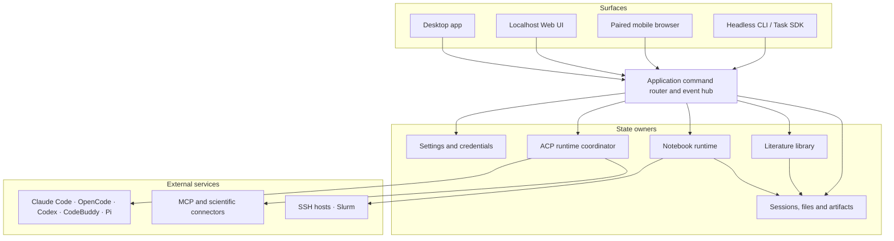

# Open-Science Roadmap

## Architecture

Layer details: [current architecture](PRD.md#8-current-architecture-what-is-actually-implemented), [security boundaries](security.md).

## Capability Map

| Area                   | Capabilities                                                                                                                   |
| ---------------------- | ------------------------------------------------------------------------------------------------------------------------------ |
| Projects and sessions  | Projects, conversation branches, writable forks, side chats, queued messages, review-gated plans, notifications, global search |
| Agents and models      | Five agent frameworks, built-in and custom providers, subscription sign-in, scenario-specific model policies, token usage      |
| Specialists and skills | Specialists, subagent delegation, file-based skills, signed marketplace, packages and GitHub imports                           |
| Scientific connectors  | Built-in life-science resources, custom MCP servers, shared credentials, per-agent access and tool permissions                 |
| Literature             | Library, collections, duplicate merge, full-text lookup, smart screening, PDF extraction, persistent annotations, citations    |
| Files and previews     | Streaming uploads, versioned text editing, previews for tables, sequences, PDFs, Office, images, code, HTML, molecules         |
| Compute                | Persistent Python/R kernels, shell, managed environments, background jobs, SSH and Slurm, `.ipynb` export                      |
| Provenance and replay  | Immutable artifact versions, lineage, optional reviewer, artifact replay checks, environment bundles                           |
| Research exchange      | `.science` packages, read-only import, writable fork, Markdown/PDF export, RO-Crate export                                     |
| Permissions and data   | Scoped grants, approved folders, network controls, central credentials, storage relocation, diagnostic export                  |
| Access and delivery    | macOS, Windows and Linux installers, auto-update, localhost Web, headless CLI/Task SDK, paired mobile, interface translations  |

Per-release detail lives in the [release notes](#releases). Surface and platform differences are in [usage scope](usage-scope.md) and [known limitations](known-limitations.md).

## Roadmap by Phase

Phases are ordered by dependency, not by date. A later phase may start before an earlier one finishes. Items need a scoped issue and maintainer prioritization before delivery.

### Phase 1: Harden existing workflows

| Item                              | Outcome                                                                                                                                                                            |
| --------------------------------- | ---------------------------------------------------------------------------------------------------------------------------------------------------------------------------------- |
| Real research reproducibility     | Python and R rerun examples across analysis types from the [Reproducibility Pilot](https://github.com/aipoch/open-science/issues/2725), with failures turned into regression tests |
| Reliability and scale             | Restart, cancellation, large-data and cross-platform journeys covered; unresolved recovery and missing evidence made visible                                                       |
| Literature-to-analysis continuity | Better source navigation and extraction quality; screening decisions keep their sources downstream                                                                                 |
| Capability quality                | Wider tested scientific connectors and skills; clearer explanation of why a capability was selected                                                                                |

### Phase 2: Portability and control

| Item                               | Outcome                                                                                              |
| ---------------------------------- | ---------------------------------------------------------------------------------------------------- |
| Stronger reproduction              | More complete environment and input capture across machines; defined conditions for session replay   |
| Model independence                 | Backend-independent gateway with consistent per-agent routing across protocols                       |
| Skill and specialist reuse         | Skill version pinning and explicit fork and update lineage                                           |
| Broader automation                 | CLI/Task SDK and browser coverage for concrete research workflows                                    |
| Context and scientific interaction | Evidence-aware capability discovery, region anchoring on image and HTML, editable scientific viewers |
| Trust and credential lifecycle     | Automated credential rotation; consistent policies across execution paths                            |

### Phase 3: Infrastructure and ecosystem

| Item                     | Outcome                                                                                    |
| ------------------------ | ------------------------------------------------------------------------------------------ |
| Cloud compute            | Managed GPU and cloud job submission with a cost and approval model                        |
| Open research commons    | Shared workflows, datasets, protocols and agents with provenance, fork lineage, governance |
| Institutional deployment | Policy administration and audit for labs, keeping local-first use                          |

## Capability Boundaries

### Traceability, replay, and scientific validity

1. **Traceability** shows an artifact version with its retained inputs, code, execution, environment inventory, and review evidence where captured.
2. **Artifact replay** re-runs an eligible version in isolation and reports what matched.
3. **Deterministic whole-session reproduction** is not provided. A matching output does not prove a sound method or conclusion.

### Non-goals

- Real-time multi-user editing of a session. Sharing is through exported records.
- A prescribed scientific ontology. Review, screening and replay checks cannot certify statistical validity.
- A hosted multi-tenant service. Local-first does not mean offline: configured providers, connectors and remote compute contact external services.

## Releases

Version-specific changes are in the [release notes](../release-notes/) and on [GitHub Releases](https://github.com/aipoch/open-science/releases). This document does not track per-version availability.

## Contributing

Open an [issue](https://github.com/aipoch/open-science/issues) with the use case, current behavior, and a checkable example. Use [Discussions](https://github.com/aipoch/open-science/discussions) for open questions and follow [CONTRIBUTING.md](../CONTRIBUTING.md).

When work lands, update the matching Capability Map row and remove or adjust the Phase item. Link planned items to an issue when one exists.
