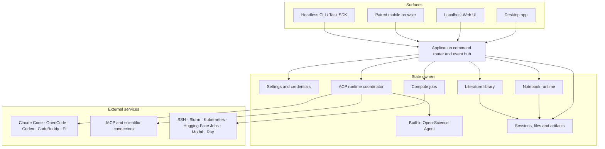

# Open-Science Roadmap

## Architecture

Layer details: [current architecture](PRD.md#8-current-architecture-what-is-actually-implemented), [security boundaries](security.md).

## Capability Map

| Area                   | Capabilities                                                                                                                                                                                                                  | Boundary                                                                                                                 |
| ---------------------- | ----------------------------------------------------------------------------------------------------------------------------------------------------------------------------------------------------------------------------- | ------------------------------------------------------------------------------------------------------------------------ |
| Projects and sessions  | Projects, conversation branches, writable forks, side chats, queued messages, review-gated plans, bookmarks, notifications, global search                                                                                     | Side chats stay out of research packages and forks                                                                       |
| Agents and models      | Built-in Open-Science Agent by default on new installations, five other selectable frameworks, built-in and custom providers, subscription sign-in, scenario-specific model policies, project memory, compaction, token usage | Protocol support follows the selected framework; no backend-independent gateway                                          |
| Specialists and skills | Specialists, subagent delegation, file-based skills, signed marketplace, packages and GitHub imports                                                                                                                          | No user-facing version pinning                                                                                           |
| Scientific connectors  | Built-in life-science resources, custom MCP servers, shared credentials, per-agent access and tool permissions                                                                                                                | Coverage depends on each upstream service                                                                                |
| Literature             | Library, collections, duplicate merge, full-text lookup, smart screening, PDF extraction, persistent annotations, citations, bibliographic CSV export                                                                         | Full text depends on the source; screening is triage, not a systematic-review protocol                                   |
| Files and previews     | Streaming uploads, versioned text editing, previews for tables, sequences, PDFs, Office, images, code, HTML, molecules                                                                                                        | The 10 GiB upload limit is separate from parsing, preview and model-context limits                                       |
| Compute                | Persistent Python/R kernels, shell, managed environments, background jobs, SSH and Slurm, Kubernetes, Hugging Face Jobs, Modal and Ray job submission, `.ipynb` export                                                        | Remote targets need user-provisioned accounts, software, and permissions; jobs run under the approved target's authority |
| Provenance and replay  | Immutable artifact versions, lineage, optional reviewer, artifact replay checks, environment bundles                                                                                                                          | Missing evidence is reported, not reconstructed; no whole-session replay                                                 |
| Research exchange      | `.science` packages, read-only import, writable fork, Markdown/PDF export, RO-Crate export                                                                                                                                    | Imports run no code and restore no credentials                                                                           |
| Permissions and data   | Scoped grants, approved folders, network controls, central credentials, storage relocation, diagnostic export                                                                                                                 | Protection varies by execution path and platform                                                                         |
| Access and delivery    | macOS, Windows and Linux installers, auto-update, localhost Web, headless CLI/Task SDK, paired mobile, interface translations                                                                                                 | Web and CLI do not imply desktop parity or a hosted multi-tenant service                                                 |

Per-release detail lives in the [release notes](#releases). Surface and platform differences are in [usage scope](usage-scope.md) and [known limitations](known-limitations.md).

## Roadmap by Phase

Phases are ordered by dependency, not by date. A later phase may start before an earlier one finishes. Items need a scoped issue and maintainer prioritization before delivery.

### Phase 1: Harden existing workflows

| Item                              | Outcome                                                                                                                                                                            |
| --------------------------------- | ---------------------------------------------------------------------------------------------------------------------------------------------------------------------------------- |
| Real research reproducibility     | Python and R rerun examples across analysis types from the [Reproducibility Pilot](https://github.com/aipoch/open-science/issues/2725), with failures turned into regression tests |
| Reliability and scale             | Restart, cancellation, large-data and cross-platform journeys covered; unresolved recovery and missing evidence made visible                                                       |
| Literature-to-analysis continuity | Better source navigation and extraction quality; screening decisions keep their sources downstream                                                                                 |
| Capability quality                | Wider tested scientific connectors and skills; clearer explanation of why a capability was selected                                                                                |

### Phase 2: Portability and control

| Item                               | Outcome                                                                                              |
| ---------------------------------- | ---------------------------------------------------------------------------------------------------- |
| Stronger reproduction              | More complete environment and input capture across machines; defined conditions for session replay   |
| Model independence                 | Backend-independent gateway with consistent per-agent routing across protocols                       |
| Skill and specialist reuse         | Skill version pinning and explicit fork and update lineage                                           |
| Broader automation                 | CLI/Task SDK and browser coverage for concrete research workflows                                    |
| Context and scientific interaction | Evidence-aware capability discovery, region anchoring on image and HTML, editable scientific viewers |
| Trust and credential lifecycle     | Automated credential rotation; consistent policies across execution paths                            |

### Phase 3: Infrastructure and ecosystem

| Item                     | Outcome                                                                                                                                                                                 |
| ------------------------ | --------------------------------------------------------------------------------------------------------------------------------------------------------------------------------------- |
| Cloud compute            | Managed GPU and cloud job submission with a cost and approval model — job submission on user-connected Kubernetes, Hugging Face Jobs, Modal and Ray targets ships with per-job approval |
| Open research commons    | Shared workflows, datasets, protocols and agents with provenance, fork lineage, governance                                                                                              |
| Institutional deployment | Policy administration and audit for labs, keeping local-first use                                                                                                                       |

## Vision

Make scientific data and tools reachable by research agents; let capability follow the scientist across models and infrastructure; select and compose capabilities from the task and its evidence; connect reading, computation, review and verification without losing provenance; and share reproducible research infrastructure across labs. These are directions, not completion gates.

## Capability Boundaries

### Traceability, replay, and scientific validity

1. **Traceability** shows an artifact version with its retained inputs, code, execution, environment inventory, and review evidence where captured.
2. **Artifact replay** re-runs an eligible version in isolation and reports what matched.
3. **Deterministic whole-session reproduction** is not provided. A matching output does not prove a sound method or conclusion.

### Packages, forks, and environments

- **Research package:** selected session history, branches, file versions, Notebook records, verification evidence, environment locks and optional literature PDFs. Side chats, private bookmarks and credentials are excluded. Import is read-only and executes nothing.
- **Writable fork:** continues a copied history under new identities without changing its source. Local forks can copy bookmarks; side chats are excluded. Omitted file evidence cannot be recreated.
- **Environment bundle:** restorable only when complete and compatible with the target platform. It is not a live-runtime export, an external lock-file import, or an overwrite of an existing environment.

### Reading context and notes

Conversation annotations send selected evidence to the agent. Private bookmarks only help return to a location. Persistent PDF annotations and document notebooks keep marks and notes on the document, and library attachments share their notebook across references, projects and sessions. Annotated PDF export creates a separate file and leaves the source bytes unchanged.

### Frameworks, platforms, and trust

Model compatibility follows the chosen framework and endpoint protocol; scenario-specific settings are routing choices, not a universal gateway. Notebook network policy covers approved destinations and, when the public read channel is available, restricted HTTPS reads to other public hosts. Windows protected execution requires administrator setup, and WSL2 Bash is an explicit opt-in preview. Sandbox coverage is not identical for every external tool or provider. See [security](security.md) and [known limitations](known-limitations.md).

### Non-goals

- Real-time multi-user editing of a session. Sharing is through exported records.
- A prescribed scientific ontology. Review, screening and replay checks cannot certify statistical validity.
- Offline-only operation. Configured providers, connectors and remote compute contact external services.

## Releases

Version-specific changes are in the [release notes](../release-notes/) and on [GitHub Releases](https://github.com/aipoch/open-science/releases). This document does not track per-version availability.

## Contributing

Open an [issue](https://github.com/aipoch/open-science/issues) with the use case, current behavior, and a checkable example. Use [Discussions](https://github.com/aipoch/open-science/discussions) for open questions and follow [CONTRIBUTING.md](../CONTRIBUTING.md).

- When work lands, update the matching Capability Map row and remove or adjust the Phase item. Link planned items to an issue when one exists.
- Call a capability available only when its end-to-end path exists. Do not mark an area complete because one slice shipped.
- For implementation proposals, call out historical-data compatibility, new states or enums, and persistence changes separately before choosing a design.
