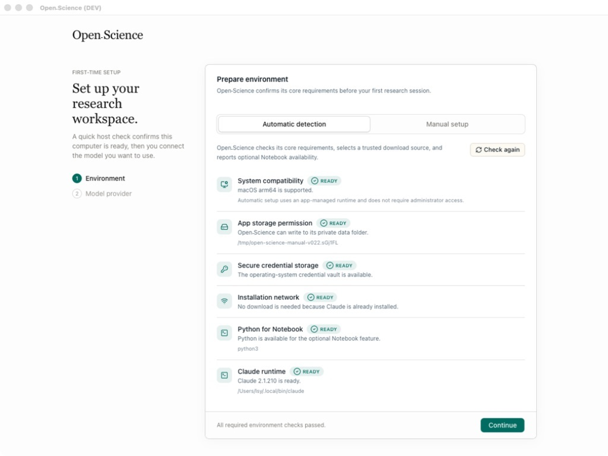
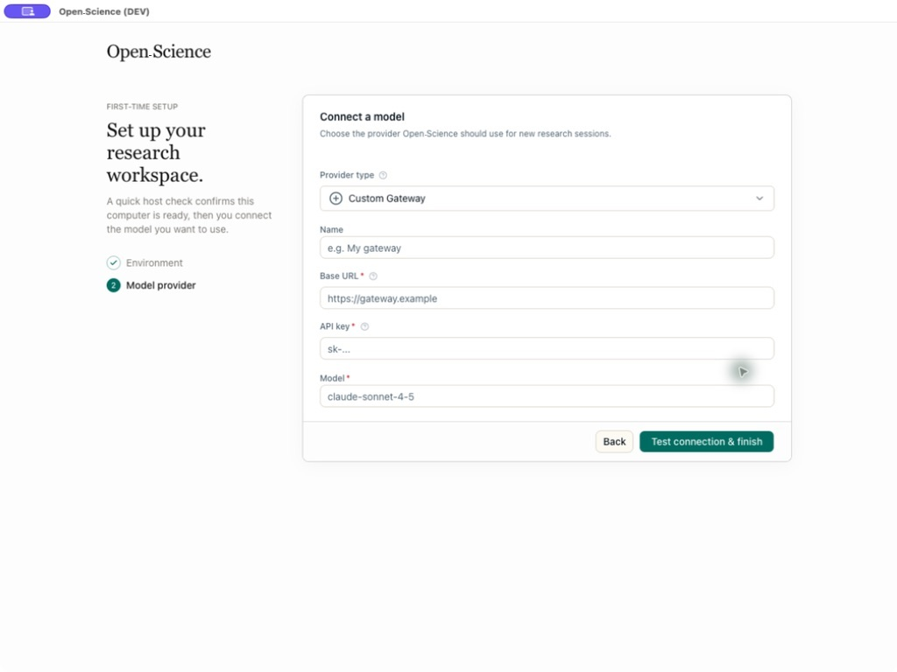
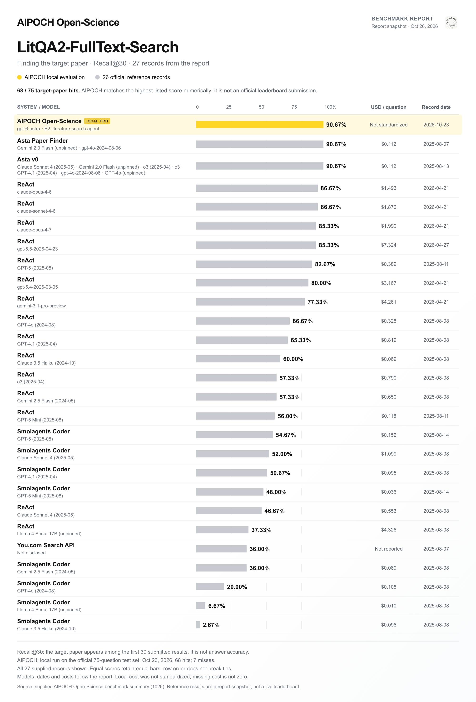
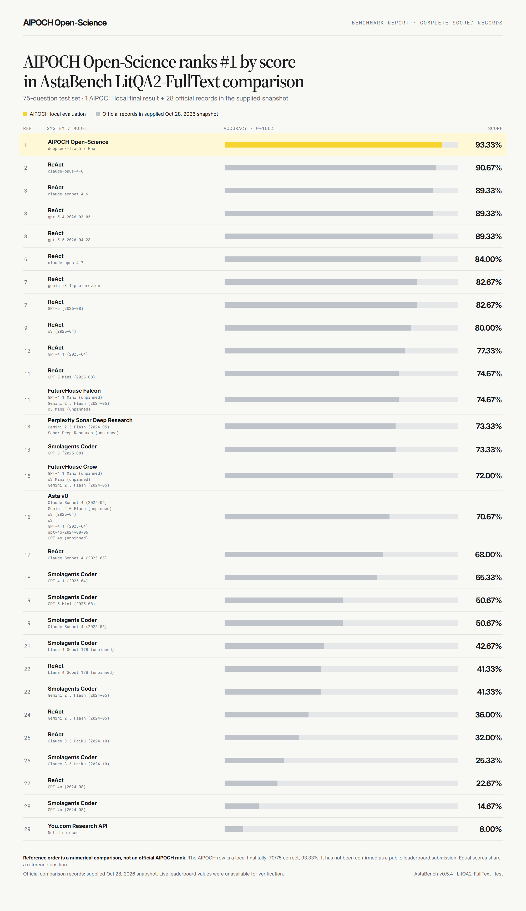
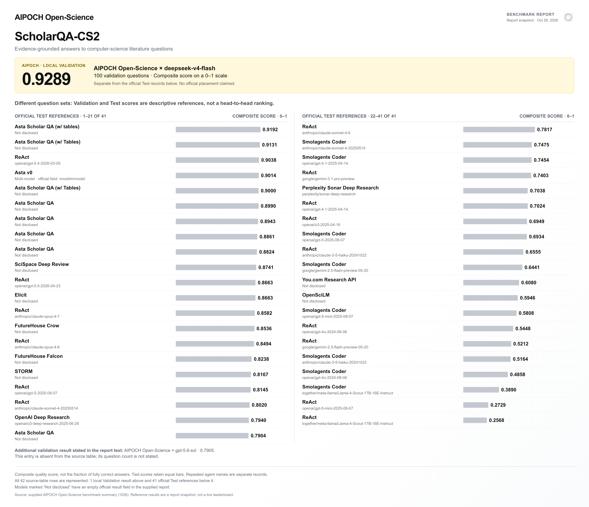
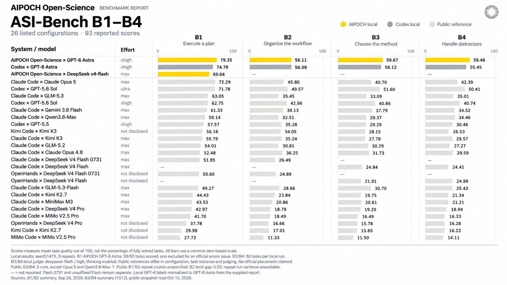
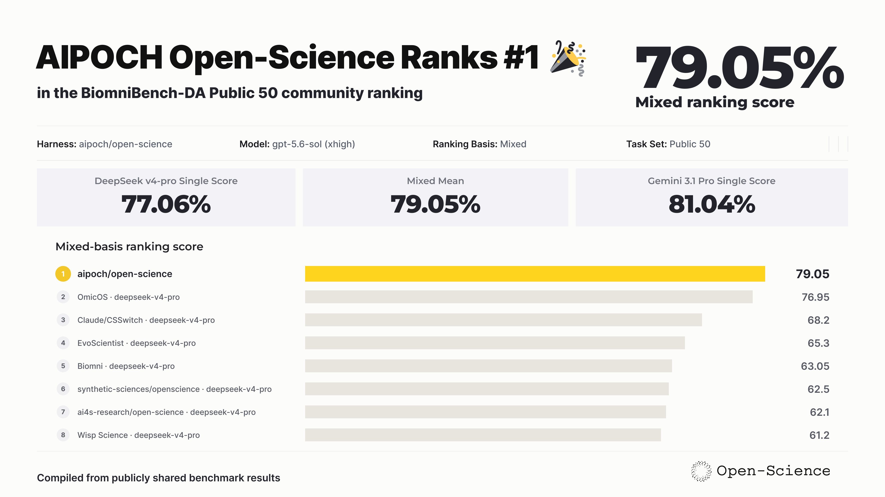

<h1 align="center">AIPOCH Open-Science</h1>

<p align="center">
  KI-Forschungsumgebung für reproduzierbare Wissenschaft — quelloffen, lokal betrieben und modellunabhängig.
</p>

<p align="center">
  <a href="https://aipoch.com/open-science/download">
    
  </a>
  <a href="https://github.com/aipoch/open-science/releases/latest">
    
  </a>
  <a href="https://doi.org/10.5281/zenodo.22252246">
    
  </a>
  <a href="https://arxiv.org/abs/2610.17110">
    
  </a>
  <a href="#benchmark-ergebnisse">
    
  </a>
  <a href="https://github.com/aipoch/open-science/releases/latest">
    
  </a>
  <a href="../../LICENSE">
    
  </a>
  <a href="https://aipoch.com/open-science">
    
  </a>
</p>

<p align="center">
  <a href="../../README.md"></a>
  <a href="../zh-Hans/README.md"></a>
  <a href="../zh-Hant/README.md"></a>
  <a href="../ja/README.md"></a>
  <a href="../ko/README.md"></a>
  <a href="../fr/README.md"></a>
  <a href="../ru/README.md"></a>
  <a href="../de/README.md"></a>
  <a href="../es/README.md"></a>
</p>

> Dieses Dokument ist eine Übersetzung der englischen `README.md`. Bei Abweichungen ist die [englische Version](../../README.md) maßgeblich.

[AIPOCH Open-Science](https://aipoch.com/open-science) ist eine quelloffene Arbeitsumgebung für die Forschung mit KI. Beginnen Sie mit einer Frage, einer wissenschaftlichen Veröffentlichung oder einer Datendatei. Beschreiben Sie in eigenen Worten, was Sie herausfinden möchten, und arbeiten Sie mit einem KI-Agenten, um Belege zu sichten, Daten zu analysieren oder ein Diagramm zu erstellen.

Um nachzuvollziehen, wie ein Ergebnis zustande kam, können Sie die verfügbaren Eingabedaten, den Code und den Ausführungsverlauf einsehen. Wenn Sie Ihre Arbeit teilen möchten, wählen Sie die Gesprächszweige, Dateiversionen, Notebook-Aufzeichnungen und Prüfnachweise aus und exportieren Sie sie als `.science`-Paket.

### 💡 AIPOCH Open-Science v1.0.8 — Neuerungen

_4. November 2026_

- **Einstellungen**: Funktionsbezogene Registerkarten ordnen App-Informationen, Diagnose und Hilfe.
- **Literaturimport**: Bis zu **100** DOI-, arXiv- oder PubMed-Kennungen oder offizielle Artikellinks gleichzeitig importieren, normalisieren und deduplizieren.
- **KI-Studienübersichten**: Forschungsfrage, Studienpopulation, Methoden, Hauptergebnisse und Grenzen aus Volltext oder Abstract zusammenfassen und die Textquelle anzeigen.
- **Sitzungsressourcen**: Alle fünf Agenten-Frameworks geben Prozesse nach abgeschlossenen Sitzungen frei und reduzieren die Speicheransammlung.
- **Modellunterstützung**: Tencent TokenHub ergänzt Hy4 und DeepSeek V4.1 Flash sowie Bildeingaben für ausgewählte Modelle.
- **Wissenschaftliche Daten und PDF**: eQTL Catalogue mit GRCh38-Prüfung wiederherstellen sowie PDF-Lesereihenfolge und Textextraktion verbessern.
- **Zuverlässigkeit**: R-Abhängigkeitsprüfung und Artefakt-Provenienz verbessern; Updates, Downloads, Sandbox-Netzwerk und Pi-Installation korrigieren.

[Vollständige Versionshinweise v1.0.8](https://github.com/aipoch/open-science/releases/tag/v1.0.8)

<p align="center">
 
</p>

## Inhaltsverzeichnis

- [Schnellstart](#-schnellstart)
- [AIPOCH Open-Science `.science`-Forschungspakete](#aipoch-open-science-science-forschungspakete)
- [AIPOCH Open-Science: Paper und Zitierung](#aipoch-open-science-paper-und-zitierung)
- [Benchmark-Ergebnisse](#benchmark-ergebnisse)
- [Kernkompetenzen](#kernkompetenzen)
- [Modellanbieter](#modellanbieter)
- [Daten, Berechtigungen und Vertrauen](#daten-berechtigungen-und-vertrauen)
- [Entwicklung & Verpackung](#entwicklung--verpackung)
- [Häufig gestellte Fragen](#häufig-gestellte-fragen)
- [Mitwirkende](#mitwirkende)
- [Machen Sie mit](#machen-sie-mit)
- [Lizenz](#lizenz)
- [Sterngeschichte](#sterngeschichte)

## 🚀 Schnellstart

### 1. Laden Sie die App herunter

Öffnen Sie die [offizielle Download-Seite](https://aipoch.com/open-science/download) und wählen Sie das passende Installationspaket aus:

| Ihr Computer                              | Wählen Sie                                            |
| ----------------------------------------- | ----------------------------------------------------- |
| macOS 12+ – Apple Silicon (M1 oder neuer) | Das macOS DMG für Apple Silicon / ARM64               |
| macOS 12+ – Intel                         | Das macOS DMG für Intel / x64                         |
| Windows 10/11 x64                         | Das Windows x64-Installationsprogramm (code-signiert) |
| Linux x64                                 | Das Linux x64 AppImage- oder Debian-Paket             |
| Linux ARM64                               | Linux ARM64 AppImage- oder Debian-Paket               |

Hinweise zu Prüfungen vor der Installation finden Sie unter [Download überprüfen](../../SECURITY.md#verifying-your-download).

Die eigenständigen CLI-Archive für macOS, Linux und Windows enthalten Node.js und lassen sich ohne Homebrew oder npm verwenden.

Unter macOS können Sie die App auch mit [Homebrew](https://brew.sh) installieren:

```bash
brew install --cask open-science
```

Für die eigenständige CLI unter macOS oder Linux verwenden Sie den separaten [AIPOCH-Tap](https://github.com/aipoch/homebrew-tap):

```bash
brew install aipoch/tap/open-science
```

Die Formula enthält Node und benötigt keine laufende Desktop-App; ihre Version kann vom Desktop-Cask abweichen. Voraussetzungen und Upgrades stehen im [Leitfaden zur eigenständigen Laufzeit](../standalone-runtime.md).

Für die eigenständige CLI und Web-Oberfläche installieren Sie das veröffentlichte [npm-Paket](https://www.npmjs.com/package/@aipoch/open-science) mit **Node.js 22.13.0 oder neuer**:

```bash
npm install --global @aipoch/open-science
open-science start --no-open
open-science url
```

Öffnen Sie die ausgegebene URL, um die Einrichtung abzuschließen, oder folgen Sie der [Terminal-Einrichtungsanleitung](../../packages/open-science/CLI.md#first-run-setup-codex). npm unterstützt macOS ARM64/x64, glibc-Linux ARM64/x64 und Windows x64; die Desktop-App ist nicht erforderlich. Lassen Sie optionale npm-Abhängigkeiten aktiviert und beachten Sie die [Linux-Voraussetzungen und Aktualisierungshinweise](../standalone-runtime.md#install-from-npm). Die URL enthält ein Authentifizierungstoken; halten Sie sie geheim.

Unter Windows bleiben Forschungsdaten bei einer Neuinstallation erhalten. Für eine vollständige Bereinigung nutzen Sie das [Werkzeug zum Zurücksetzen](../../scripts/windows-reset/README.md), das lokale Daten nach Bestätigung dauerhaft löscht.

### 2. Schließen Sie die Ersteinrichtung ab

Folgen Sie dem Einrichtungsassistenten: **Umgebung → Datenspeicherort → Agent-Runtime → Modellanbieter → Notebook-Runtime**.

Schließen Sie die erforderlichen Prüfungen für Umgebung und Agent-Runtime ab und testen Sie die Modellverbindung. Python/R Notebook ist optional; Notebook und Datenspeicherort lassen sich später in den Einstellungen ändern.

Darstellung und Benachrichtigungen finden Sie in den Systemeinstellungen. Unter **Allgemein** finden Sie die Anleitung zur manuellen Installation und Aktualisierung.

<table>
<tr>
<td width="50%"></td>
<td width="50%"></td>
</tr>
<tr>
<td align="center"><sub>Hostkompatibilitäts-, Speicher- und Netzwerkprüfungen</sub></td>
<td align="center"><sub>Anbieter, API-Schlüssel, Endpunkt und Modellvalidierung</sub></td>
</tr>
</table>

### 3. Starten Sie ein Forschungsprojekt

1. Klicken Sie auf **Neues Projekt**, öffnen Sie eine Sitzung und beschreiben Sie Forschungsziel, Eingaben und gewünschte Ergebnisse.
2. Hängen Sie Dateien an, wählen Sie Modell und Freigabeprofil und senden Sie die Aufgabe. Mit `@` verweisen Sie auf Projektdateien, mit `/` wählen Sie eine Fähigkeit.
3. Prüfen Sie Werkzeugaktivitäten und Freigabeanfragen, betrachten Sie die Ergebnisse und die verfügbaren Belege in der **Provenienzansicht**.

> Screenshots in dieser README-Datei veranschaulichen den Arbeitsablauf. Beschriftungen, Kataloge und andere Schnittstellendetails können von der von Ihnen installierten Version abweichen.

## AIPOCH Open-Science `.science`-Forschungspakete

Exportieren Sie eine abgeschlossene Forschungssitzung als portables `.science`-Paket zur Prüfung, Übergabe und Archivierung. Wählen Sie die Gesprächsverzweigungen, Dateiversionen, Notebook-Aufzeichnungen und Verifikationsevidenz aus, die enthalten sein sollen, und importieren Sie das Paket anschließend in ein anderes Projekt oder auf einen anderen Rechner.

Export und Import sind in der Desktop-App, in lokalen Web-Sitzungen und über die headless CLI verfügbar. Entfernte Web-Sitzungen können keine beliebigen lokalen Paketpfade lesen oder schreiben.

**Exportieren → übertragen → prüfen**

1. Exportieren Sie eine abgeschlossene Sitzung und wählen Sie die einzuschließenden Inhalte aus.
2. Übertragen Sie die `.science`-Datei an eine mitwirkende Person oder auf einen anderen Rechner.
3. Importieren Sie die Datei in ein Projekt. Rechts zeigt **Research replay** den aufgezeichneten Ablauf; links können Sie Fragen stellen und auf feste Schritte verweisen.

Importierte Aufzeichnungen bleiben schreibgeschützt; die Wiedergabe führt weder Code noch Modellaufrufe aus und stellt keine Anmeldeinformationen wieder her. Die erste Frage erstellt eine zugehörige beschreibbare Diskussion. Mit **Fork to continue** erstellen Sie eine Arbeitskopie. Eine erneute Ausführung benötigt weiterhin ein vollständiges Rezept, notwendige Eingaben und eine verfügbare Laufzeit.

Side Chats, private Lesezeichen und Anmeldeinformationen sind ausgeschlossen; enthaltene Dateien hängen von der Exportauswahl ab. Empfangene Prüfprotokolle beschreiben die Prüfungen des Absenders, keinen erneuten Lauf auf diesem Computer. Siehe die [Anleitung für `.science`-Pakete](https://aipoch.com/docs/guides/research-packages/).

## AIPOCH Open-Science: Paper und Zitierung

**[AIPOCH Open-Science: An Open-Source AI Research Workbench with Reproducible .science Packages](https://arxiv.org/abs/2610.17110)**

arXiv-Preprint · [v1](https://arxiv.org/abs/2610.17110v1) · Eingereicht am 12. Oktober 2026.

Unser Preprint stellt AIPOCH Open-Science vor, eine quelloffene KI-Forschungsumgebung mit portablen `.science`-Paketen zum Teilen von Forschungskontext, Artefaktversionen und Prüfprotokollen. Lesen Sie das Paper für Einzelheiten zum Austauschdesign der Pakete und zur kontrollierten Evaluation.

Wenn Sie AIPOCH Open-Science in Ihrer Forschung verwenden, können Sie den Preprint zitieren:

<details>
<summary>BibTeX-Zitat</summary>

```bibtex
@misc{ouyang2026aipochopenscienceopensourceai,
      title={AIPOCH Open-Science: An Open-Source AI Research Workbench with Reproducible .science Packages},
      author={Wen Ouyang and Bocheng Huang and Qianyu Yao and Fei Sun and Minying Deng and Haoyue Cheng and Wenwen Zhou and Lei Mou and Yusi Wei and Jiang Li and Kun Zhu and Lei Wang and Yi Feng and Jiaheng Dai and Ke Qian and Dan Wang and Yahui Wang and Chenyi Wang and Mingsheng Lyu and Yaqiang Zhang and Ping Zheng and Chunhua Tang and Xinge Ma and Xu Zhang and Youjia Fan and Can Lu and Zhijun Dai and Man Hu and Qiqi Xie and Beinan Liu and Yuanning Guo and Yunze Liu and Jinhong Jiang and Xianjun Fu and Mingwei Zhang and Yuanji Xu and Shilin Xia and Bowen Yang and Mingjun Yu and Jingdun Xie and Xuwei Chen and Xia Zou and Yuzhou Xue and Jianguo Zhou and Chunhao Cao and Donghao Tian and Lei Huang and Jinxiao Li and Shengrong Long and Zefeng Song and Honglin Li and Jiang Luo and Wenying Jiang and Shanshan Li and Lei Dai and Ning Jiang and Ying Cai and Chaohui Li and Chunyan Peng and Hetong Zhao and Angqing Li and Chunyan Yang and Chongyang Sun and Yong Li and Xinyu Shi and Wei Dai and Ming Peng and Chen Sang and Yuanyuan Han and Desong Qiu and Haixin Miao and Jian Xu and Yi Chen and Xiaoliang Shi and Tian Shen and Teng Hu and Shuhao Wang and Yingyong Hou and Huimei Wang},
      year={2026},
      eprint={2610.17110},
      archivePrefix={arXiv},
      primaryClass={cs.SE},
      url={https://arxiv.org/abs/2610.17110},
}
```

</details>

## Benchmark-Ergebnisse

AIPOCH hat AIPOCH Open-Science bei Aufgaben vom Auffinden einer Publikation über Fragen zu ihrem Inhalt bis zur Ausführung eines Forschungsplans bewertet. Die folgenden Ergebnisse stammen aus eigenen Testläufen von AIPOCH. Jeder Wert bezieht sich auf eine bestimmte Aufgabe und Bewertungskonfiguration.

| Aufgabe                                 | Ergebnis von AIPOCH Open-Science                                                                                                                                                                          |
| --------------------------------------- | --------------------------------------------------------------------------------------------------------------------------------------------------------------------------------------------------------- |
| Zielpublikation finden                  | Bei **68 von 75 Testfragen** erschien die Zielpublikation unter den ersten 30 Ergebnissen von LitQA2-FullText-Search (**90.67% Recall@30**, gpt-6-astra).                                                 |
| Fragen anhand der Literatur beantworten | In einem separaten LitQA2-FullText-Lauf beantwortete Open-Science **70 von 75 Testfragen richtig** (**93.33% Genauigkeit**, deepseek-flash mit Max-Reasoning).                                            |
| Eine Antwort mit Quellen zusammenführen | Auf 100 Validierungsfragen von ScholarQA-CS2 erreichte Open-Science mit deepseek-v4-flash einen **zusammengesetzten Qualitätswert von 0.9289/1**. Die offiziellen Testreferenzen verwenden andere Fragen. |
| Forschungsabläufe ausführen             | In lokalen ASI-Bench-Läufen mit demselben Modell erzielte Open-Science auf B4 **59.46**, Codex **55.45**. Auf B2 waren die Werte nahezu gleich (**56.11** und **56.09**).                                 |
| Biomedizinische Daten analysieren       | Auf BiomniBench-DA Public 50 bewerteten zwei Bewertungsmodelle die Ergebnisse mit **81.04** und **77.06**. Ihr gleich gewichteter Mittelwert betrug **79.05**.                                            |

### AstaBench — Literaturaufgaben

<details>
<summary><strong>Literatursuche — Zielpublikation bei 68 von 75 Fragen gefunden</strong></summary>

AIPOCH führte den offiziellen LitQA2-FullText-Search-Testsplit mit 75 Fragen lokal aus. Der Recall@30 entsprach dem höchsten Wert im Vergleichsstand vom 26. Oktober 2026. Dieser lokale Lauf war weder eine Einreichung für die offizielle Rangliste noch eine dortige Platzierung.



Recall@30 zählt einen Treffer, wenn die Zielpublikation unter den ersten 30 Ergebnissen erscheint; die Antwortgenauigkeit wird damit nicht gemessen. Die Kostenberechnung wurde zwischen den Läufen nicht vereinheitlicht.

</details>

<details>
<summary><strong>Volltext-Fragenbeantwortung — 70 von 75 Antworten richtig</strong></summary>

AIPOCH führte den LitQA2-FullText-Testsplit mit 75 Fragen in AstaBench v0.5.4 aus. Die Grafik ordnet das lokale Ergebnis und historische Referenzwerte nach Punktzahl. „#1“ bezieht sich auf diesen Vergleich.



Die Genauigkeit misst den Anteil richtiger Antworten. Hier sind 93.33% die lokale Antwortgenauigkeit und 90.67% eine historische Referenzgenauigkeit. Die Suchgrafik oben verwendet eine andere Kennzahl. Die Referenzen wurden am 28. Oktober 2026 erfasst; der höchste Referenzwert wurde am 2. November erneut geprüft.

</details>

<details>
<summary><strong>Qualität belegter Antworten — lokale Validierung und offizielle Testreferenzen</strong></summary>

Das lokale ScholarQA-CS2-Ergebnis misst die Qualität zitierter Antworten auf 100 Validation-Fragen. Die Referenzen stammen aus dem Testsplit; die Werte begründen daher keine Rangfolge aus einem direkten Vergleich.



Der zusammengesetzte Wert liegt auf einer Skala von 0 bis 1; er ist nicht der Prozentsatz vollständig richtig beantworteter Fragen.

</details>

### ASI-Bench — Pläne ausführen und Methoden auswählen

Die vier Bedingungen verlangen die Ausführung eines vorgegebenen Plans (B1), die Organisation eines Arbeitsablaufs (B2), die Auswahl von Forschungsmethoden (B3) oder Forschung mit ablenkenden Informationen (B4). Die ersten beiden Zeilen der Grafik vergleichen lokale Läufe mit demselben GPT-6-Astra-Modell.



Open-Science erzielte auf B1–B4 **79.35, 56.11, 59.67 und 59.46**; die lokale Codex-Referenz erzielte **74.78, 56.09, 58.12 und 55.45**. Die B2-Werte waren nahezu gleich. Andere veröffentlichte Läufe unterscheiden sich bei Aufgabeninstanzen, Konfigurationen oder Bewertung.

Der lokale B1-Wert umfasst 59 Aufgaben nach einem Ausschluss wegen eines Problems im Bewertungssystem. Für B1/B2 wurden drei lokale Wiederholungen berichtet. B3/B4 verwendeten Open-Science v0.32.0 und ein Ersatz-Bewertungsmodell; jeder Wert ist der Mittelwert aus drei Läufen mit je 60 Aufgaben.

### BiomniBench-DA — Biomedizinische Datenanalyse

Auf dem Aufgabensatz Public 50 bewertete Gemini 3.1 Pro die Ergebnisse mit **81.04** und DeepSeek v4-pro mit **77.06**. AIPOCH berichtet ihren gleich gewichteten Mittelwert **79.05** für die Konfiguration gpt-5.6-sol (xhigh).

<details>
<summary><strong>Bewertungen und historische Referenzen — unterschiedliche Abdeckung durch Bewertungsmodelle</strong></summary>

Die Grafik kombiniert Einträge mit unterschiedlicher Abdeckung durch Bewertungsmodelle. „#1“ bezeichnet die Reihenfolge dieser Sammlung. Eine Rangliste nach einem gemeinsamen Bewertungsverfahren würde vergleichbare Bewertungen aller Einträge erfordern.



79.05 ist ein mittlerer Bewertungswert dieser internen Evaluation.

</details>

**Bewertungsumfang:** Die Berichte umfassen lokale oder interne Läufe von August bis November 2026 mit den angegebenen Modellen und Datensplits; für die aktuelle Version wurden sie nicht wiederholt. Referenzwerte sind historische Momentaufnahmen, keine Live-Ranglisten. Werte verschiedener Benchmark-Familien sind nicht direkt vergleichbar, und numerische Unterschiede belegen keine statistische Signifikanz.

Details stehen im [AstaBench- und ASI-Bench-Bericht](https://aipoch.com/benchmark/open-science) sowie im [BiomniBench-DA-Bericht](https://aipoch.com/blog/open-science-biomnibench-da).

## Kernkompetenzen

AIPOCH Open-Science verbindet Projektverwaltung, modellübergreifende Agentenausführung, Python- und R-Notebooks, wissenschaftliche Datenkonnektoren, unveränderliche Artefaktversionen mit Provenienz und berechtigungsbasierte Human-in-the-Loop-Kontrolle in einem lokalen Arbeitsbereich. Maßgeblich für veränderliche Kataloge, Paketdetails und neue Optionen sind die installierte App und die [neuesten Versionshinweise](https://github.com/aipoch/open-science/releases/latest).

| Bereich                                      | Kernfunktionen                                                                                                                                                                                                                                                                                                                                                                                                                                                                                                                                                                                                                                                                                                                                                                                                                                                                                                                                                                                                                                                                                                                                                                                       |
| -------------------------------------------- | ---------------------------------------------------------------------------------------------------------------------------------------------------------------------------------------------------------------------------------------------------------------------------------------------------------------------------------------------------------------------------------------------------------------------------------------------------------------------------------------------------------------------------------------------------------------------------------------------------------------------------------------------------------------------------------------------------------------------------------------------------------------------------------------------------------------------------------------------------------------------------------------------------------------------------------------------------------------------------------------------------------------------------------------------------------------------------------------------------------------------------------------------------------------------------------------------------- |
| **Wissenschaftliche Fähigkeiten**            | Erweitern Sie Forschung mit **24 integrierten Fähigkeiten** und **525 Fähigkeiten** aus dem [Skills Marketplace](https://github.com/aipoch/openscience-skill-marketplace), mit Ein-Klick-Installation und Updates. Erstellen Sie Fähigkeiten im Dialog oder aus abgeschlossener Arbeit, importieren Sie Pakete oder GitHub-Quellen und speichern Sie GitHub-Repositorys zur Wiederverwendung im Importablauf. Das Speichern installiert keine Fähigkeiten. Beiträge werden nach Prüfung veröffentlicht; ein lokaler Import veröffentlicht sie nicht.                                                                                                                                                                                                                                                                                                                                                                                                                                                                                                                                                                                                                                                 |
| **Konnektoren**                              | Greifen Sie über **48 integrierte Konnektoren** auf wissenschaftliche Ressourcen zu oder ergänzen Sie eigene lokale und entfernte MCP-Konnektoren. Einige integrierte Quellen sind standardmäßig deaktiviert und müssen je Quelle aktiviert werden. Verwalten Sie Werkzeugberechtigungen und importieren oder exportieren Sie Konfigurationen.                                                                                                                                                                                                                                                                                                                                                                                                                                                                                                                                                                                                                                                                                                                                                                                                                                                       |
| **Spezialisten und Delegation**              | Installieren Sie **10 Spezialisten** aus dem [Specialist Marketplace](https://github.com/aipoch/openscience-specialist-marketplace) oder erstellen Sie persönliche Spezialisten für Aufgaben des Hauptagenten. Pakete lassen sich importieren und exportieren; Beiträge werden nach Prüfung veröffentlicht, lokale Importe veröffentlichen nichts.                                                                                                                                                                                                                                                                                                                                                                                                                                                                                                                                                                                                                                                                                                                                                                                                                                                   |
| **Modelle und Agenten-Backends**             | Nutzen Sie Cloud-Modelle, kompatible Gateways oder Claude- und Codex-Abonnements. Wählen Sie Claude Code, OpenCode, Codex, CodeBuddy oder Pi als Backend, mit Verbindungsprüfung, Bildeingaben und einstellbarer Denkintensität.                                                                                                                                                                                                                                                                                                                                                                                                                                                                                                                                                                                                                                                                                                                                                                                                                                                                                                                                                                     |
| **Projekte, Sitzungen und Forschungspakete** | Organisieren Sie Projekte mit angehefteten Sitzungen, Nachrichtenverzweigungen, Nebengesprächen und wiederherstellbarem Verlauf. Übertragen Sie ein **portables `.science`-Forschungspaket** mit Gesprächsverzweigungen, ausgewählten Dateiversionen, Notebook-Aufzeichnungen und Verifikationsevidenz in ein anderes Projekt oder auf einen anderen Rechner. Importe sind schreibgeschützt, führen keinen Code aus und stellen keine Anmeldedaten wieder her; Nebengespräche und Lesezeichen sind ausgeschlossen, Dateien folgen der Exportauswahl.                                                                                                                                                                                                                                                                                                                                                                                                                                                                                                                                                                                                                                                 |
| **Prüfagent**                                | Aktivieren Sie bei Bedarf die automatische Prüfung, um Antworten, Ausführungsprotokolle und zugehörige Dateibelege eines abgeschlossenen Agentendurchlaufs in einem eigenen Kontext zu prüfen. Sie erhalten belegte Ergebnisse mit den Status Bestanden, Warnung oder Fehler; bei Problemen sind Korrekturen durch den Hauptagenten und erneute Prüfungen mit begrenzter Rundenzahl möglich. Prüfprotokolle und Bearbeitungsstände bleiben erhalten; die Prüfung beschränkt sich auf die für diesen Durchlauf verfügbaren Aufzeichnungen.                                                                                                                                                                                                                                                                                                                                                                                                                                                                                                                                                                                                                                                            |
| **Python, R, Notebooks und HPC**             | Führen Sie Python, R, Notebook und Befehlszeile lokal in verwalteten Umgebungen oder eigenen Interpretern aus, mit Hintergrundausführung und Verlauf. SSH und Slurm setzen Host, Software, Ressourcen und Rechte gemäß der nachfolgenden FAQ zu entfernten Berechnungen voraus.                                                                                                                                                                                                                                                                                                                                                                                                                                                                                                                                                                                                                                                                                                                                                                                                                                                                                                                      |
| **Literaturbibliothek**                      | Importieren und verwalten Sie Literatur und PDFs mit Sammlungen, Tags, Projektverknüpfungen, Notizen und dem Zusammenführen von Duplikaten. Entdecken Sie über Semantic Scholar Referenzen und zitierende Arbeiten, laden Sie Zusatzanhänge herunter und betrachten Sie sie in der Vorschau; PDFs und Bibliografiedateien lassen sich per Drag-and-drop importieren. Finden Sie frei zugängliche Volltexte, lesen Sie PDFs, extrahieren Sie Abbildungen und Tabellen und nutzen Sie Bibliotheksquellen für KI-gestützte Analysen. Für Referenzen mit gültiger DOI können Sie Crossref manuell auf bekannte Rücknahmen oder Korrekturen prüfen; dabei wird die DOI an Crossref gesendet, und wegen unvollständiger Abdeckung belegt ein fehlender Hinweis nicht, dass eine Arbeit unbeeinträchtigt ist. Erstellen Sie Literaturverzeichnisse, exportieren Sie Referenzen als BibTeX oder RIS und Smart-Screening-Entscheidungen als CSV. Setzen Sie den Lesestatus manuell auf Ungelesen, Wird gelesen oder Gelesen, aktualisieren Sie ausgewählte Literaturangaben gemeinsam und filtern Sie nach dem Status. Durchsuchen Sie persönliche Notizen über das vorhandene Suchfeld für Literaturangaben. |
| **Wissenschaftliche Dateien und Vorschauen** | Laden Sie Dateien bis **10 GiB pro Datei** hoch, organisieren Sie Projektdateien und betrachten Sie wissenschaftliche Daten, PDFs, Office-Dokumente, Bilder, Code und Molekülstrukturen. Diese Upload-Grenze garantiert nicht, dass ein Modell alles lesen kann: Kontext, Anhangsanalyse und Vorschauen haben eigene Grenzen. Große Dateien erfordern meist abschnittsweises Lesen oder Analysieren per Code.                                                                                                                                                                                                                                                                                                                                                                                                                                                                                                                                                                                                                                                                                                                                                                                        |
| **Artefakte und Provenienz**                 | Speichern Sie unveränderliche Ergebnisversionen mit verfügbarem Erzeugungscode, Eingaben, Ausführungsverlauf, Umgebungsinformationen und Prüfnachweisen. Importieren Sie Artefakte aus autorisierten Ordnern; AIPOCH Open-Science kopiert jede importierte Datei in den verwalteten Artefaktspeicher. Auf dem Desktop können geeignete Versionen mit vollständigem Rezept, benötigten Eingaben und nutzbarer Laufzeit wiederholt, Ausgaben verglichen und Prüfprotokolle exportiert werden. Fehlende Nachweise können die Prüfung verhindern; Wiederholung belegt keine wissenschaftliche Gültigkeit.                                                                                                                                                                                                                                                                                                                                                                                                                                                                                                                                                                                                |

Bei Koordinatenabfragen im eQTL Catalogue prüft Open-Science, ob die Koordinaten zum Referenzgenom GRCh38 gehören.

Importieren Sie Literaturangaben, Schlagwörter, Sammlungen und Quellenlinks aus Zotero 10 oder höher, das auf demselben Computer läuft. Lokale PDF-Anhänge können Sie optional kopieren; der Import ist einseitig und ändert Zotero nicht.

Fügen Sie eine Literaturangabe über eine DOI, eine arXiv-ID, eine PMID, eine PMCID oder einen unterstützten Artikellink hinzu oder fügen Sie bis zu 100 Literaturangaben mit jeweils einem Eintrag pro Zeile ein. Prüfen und bearbeiten Sie eine einzelne Literaturangabe vor dem Speichern oder wählen Sie die Einträge für einen Stapelimport aus. Volltext-PDFs können separat hinzugefügt werden.

Dauerhafte PDF-Anmerkungen und Dokumentnotizen sind verfügbar. Mit konfiguriertem Screening-Modell bewerten intelligente Sammlungen Literatur anhand Ihrer Ein- und Ausschlusskriterien. KI- und manuelle Entscheidungen bleiben getrennt und unterstützen die menschliche Prüfung.

Im Lesemodus können Agenten Notizen und Markierungen in verknüpften PDFs auflisten, auffinden und erstellen. PDF-Anmerkungen sind an die kommentierte Dateiversion gebunden und werden nicht zwischen Computern synchronisiert.

In der Detailansicht einer Publikation fasst das konfigurierte Hauptmodell Forschungsfrage, Studienpopulation, Methoden, Hauptergebnisse und Einschränkungen zusammen. Die Übersicht gibt an, ob sie auf dem Volltext oder dem Abstract beruht.

Die optionale OCR erkennt gescannte PDF-Seiten, nachdem die Komponente und die erforderlichen Sprachpakete heruntergeladen wurden. Neun Sprachpakete stehen zur Verfügung: Englisch, vereinfachtes Chinesisch, traditionelles Chinesisch, Deutsch, Spanisch, Französisch, Japanisch, Koreanisch und Russisch. Seitenbezogene Abdeckungsanzeigen zeigen, auf welchen Seiten noch Text fehlt.

Übersetzte PDFs können Fließtext und Bildunterschriften optional in ein einspaltiges, inhaltserstes Layout umbrechen; Bilder, Tabellen, Formeln und Bibliografie bleiben dabei in ihrer ursprünglichen Form, und Zuordnungen zwischen Quell- und Ausgabeseiten erleichtern den Vergleich. Bei neuen Einrichtungen sind Ordnerbeschränkungen für Notebook und Befehlszeile standardmäßig aktiviert; diese Laufzeiten bleiben im Arbeitsbereich, in freigegebenen Ordnern und bei von Werkzeugen benötigten Dateien. Die Einstellung steuert keine agenteneigenen Werkzeuge oder entfernten Computer.

In der Desktop-App lässt sich die Artefaktherkunft auch als RO-Crate 1.1 exportieren. Ein versionsgebundenes Umgebungspaket kann nur bei vollständiger Erfassung und Kompatibilität mit der Zielplattform eine verwaltete Umgebung erzeugen; es ist keine vollständige Rechnersicherung.

Durchsuchen Sie den Sharing-Marktplatz nach Forschungsbeispielen, vom Startbildschirm oder aus dem Gesprächsarbeitsbereich aus. Filtern Sie nach Kategorie, suchen Sie nach Stichworten und laden Sie Pakete aus den Detailansichten herunter.

## Modellanbieter

AIPOCH Open-Science ist modellunabhängig: Sie können große Cloud-LLM-Anbieter oder ein benutzerdefiniertes Gateway anbinden und ein bestehendes Claude- oder Codex-Abonnement verwenden. Welche Anbieter verfügbar sind, hängt derzeit vom ausgewählten Agenten-Backend und dessen unterstützten API-Protokollen ab. Folgende Verbindungsoptionen stehen zur Verfügung:

| Anbietermodus                   | Wie es funktioniert                                                                                                                                                                                                                                                                                                                                                                                                                                                                         |
| ------------------------------- | ------------------------------------------------------------------------------------------------------------------------------------------------------------------------------------------------------------------------------------------------------------------------------------------------------------------------------------------------------------------------------------------------------------------------------------------------------------------------------------------- |
| **Integrierte Cloud-Anbieter**  | Wählen Sie aus der von der installierten App angezeigten Anbieterliste aus und authentifizieren Sie sich mit dem angeforderten Schlüssel.                                                                                                                                                                                                                                                                                                                                                   |
| **Benutzerdefiniertes Gateway** | Geben Sie Basis-URL, genaue Modell-ID und ein vom gewählten Backend unterstütztes API-Protokoll an (Messages, Chat Completions oder Responses), und testen Sie die Verbindung. Entfernte Gateways erfordern HTTPS und einen API-Schlüssel. Loopback-Adressen wie `localhost`, `127.0.0.1` oder `[::1]` erlauben HTTP ohne Schlüssel; Voreinstellungen gibt es für Ollama, LM Studio, llama.cpp und vLLM. Das voreingestellte API-Format garantiert keine Server- oder Modellkompatibilität. |
| **Codex-Abonnement**            | Wählen Sie das Codex-Agenten-Framework und dann Codex-Abonnement als Anbietertyp aus.                                                                                                                                                                                                                                                                                                                                                                                                       |
| **Claude-Abonnement**           | Melden Sie sich in einem von zwei Modi an: **gemeinsam** über den Browser, wobei Anmeldedaten im standardmäßigen `~/.claude`-Profil gespeichert werden, oder **isoliert** über ein von der App verwaltetes `claude setup-token` in einem App-eigenen `CLAUDE_CONFIG_DIR`. Dieser Modus ist vollständig von `~/.claude/` getrennt und bietet neben dem Browser-Ablauf eine manuelle Token-Eingabe.                                                                                           |
| **xAI (Grok) OAuth**            | Verwenden Sie die integrierte Geräteanmeldung über xAI (Grok) OAuth. Der Zugriff hängt vom xAI-Konto und der Protokollunterstützung des gewählten Backends ab; prüfen Sie die Verbindung in der App.                                                                                                                                                                                                                                                                                        |

Es gibt 25 voreingestellte Anbieteroptionen, darunter OpenAI, Anthropic, DeepSeek und NVIDIA Build. Modelle und regionale Endpunkte hängen von installierter Version und Backend ab; maßgeblich sind Anbieterauswahl und Verbindungstest in der App.

## Daten, Berechtigungen und Vertrauen

AIPOCH Open-Science speichert Projektdaten, Einstellungen, Artefaktversionen und Provenienznachweise auf dem lokalen Computer. API-Schlüssel werden lokal abgelegt und nach Möglichkeit durch den sicheren Anmeldedatenspeicher des Betriebssystems geschützt. Protokolle bleiben lokal und werden nicht automatisch hochgeladen.

Dennoch können Daten an externe Dienste übertragen werden. Prüfen Sie insbesondere folgende Fälle:

- Modellanfragen senden den Prompt und den erforderlichen Kontext an den ausgewählten Modellanbieter.
- Websuchen und Remote-Konnektoren senden ihre angezeigten Parameter an externe Dienste.
- Lokale Konnektoren können vertrauenswürdige Befehle auf dem Computer ausführen.
- Die App kann auch Update-Server, Marktplatzkataloge und Download-Dienste für Laufzeiten oder Modelle kontaktieren.
- Anhänge, `@`-Referenzen, Protokolle und generierte Berichte können vertrauliche Forschungsdaten enthalten.

Wählen Sie das engste Berechtigungsprofil, das zur Aufgabe passt:

| Modus                | Verhalten                                                                                                                                                        | Empfohlene Verwendung                                                    |
| -------------------- | ---------------------------------------------------------------------------------------------------------------------------------------------------------------- | ------------------------------------------------------------------------ |
| `Ask for approval`   | Fragt bei Aktionen nach, die nicht durch bestehende begrenzte Freigaben oder Richtlinien vertrauenswürdiger App-Werkzeuge abgedeckt sind                         | Neue Arbeitsabläufe, sensible Daten, unbekannte Skripte                  |
| `Auto-approve edits` | Nutzt die native automatische Prüfung des Backends, sofern verfügbar; andernfalls werden nur eindeutig risikoarme Vorgänge im Arbeitsbereich automatisch erlaubt | Vertrauenswürdige Dateibearbeitung mit kontrolliertem externen Zugriff   |
| `Full access`        | Ermöglicht automatisch Bearbeitungen, Befehle, Netzwerk und Konnektoren                                                                                          | Klar abgegrenzte, vollständig vertrauenswürdige, unbeaufsichtigte Arbeit |

Das wirksame Profil hängt vom Backend und bestehenden Freigaben ab. Konnektor-, Werkzeug- und Compute-Netzwerkrichtlinien gelten ebenfalls; prüfen Sie den von der App angezeigten wirksamen Modus.

Prüfen Sie Konnektorparameter und Tool-Aktivität vor der Freigabe. API-Schlüssel, Zugriffstoken, Patientenkennungen, unveröffentlichte Daten oder vertrauliche lokale Pfade gehören niemals in Screenshots oder öffentliche Issue-Protokolle.

## Entwicklung & Verpackung

AIPOCH Open-Science besteht aus einem gewöhnlichen Node-Backend und einem Electron-Desktop-Client mit React, TypeScript, Prisma/SQLite und einer ACP-basierten Agentenlaufzeit.

Voraussetzungen für die Quellentwicklung:

- Node.js 24 (siehe [`.nvmrc`](../../.nvmrc)) mit npm
- Git
- Notebook-Ausführung ist optional und verwendet App-verwaltete Python/R-Umgebungen oder einen von Ihnen eingerichteten kompatiblen Interpreter.

```bash
git clone https://github.com/aipoch/open-science.git
cd open-science
npm install
npm run dev
```

Build-Befehle und Entwicklungsablauf stehen in der [Referenz für Entwicklung und Paketierung](development-quick-reference.md) und im [Beitragsleitfaden](../../CONTRIBUTING.md).

### Localhost-Web- und Headless-Modi

Die Web-Oberfläche läuft mit einem gewöhnlichen Node-Backend, ohne Electron oder grafische Anzeige.

```bash
npm run dev:web
npm run pack:backend
```

Die Web-Oberfläche läuft mit einem gewöhnlichen Node-Backend, ohne Electron oder grafische Anzeige. `npm run dev:web` und `npm run dev:headless` bauen und starten Backend und Web-Oberfläche; sie starten weder Desktop noch Infobereich. `OPEN_SCIENCE_WEB_PORT` wählt den Port (Standard `44100`); Strg+C beendet den Vordergrunddienst geordnet.

Quellentwicklung benötigt Node.js 24. Das veröffentlichte npm-Paket und das lokal gebaute eigenständige npm-Tarball benötigen Node.js >=22.13.0. Release-Archive, Homebrew-Formula und Desktop-Befehlsstarter enthalten ihre eigene Laufzeit.

Desktop-App und Browser teilen denselben Dienst. App-Verbindungen und eine ausdrückliche Halteanforderung durch `open-science start` halten ihn am Laufen. Das Beenden der letzten App stoppt den Dienst nur, wenn keine ausdrückliche Halteanforderung mehr besteht.

[CLI](../../packages/open-science/CLI.md) · [Node](../standalone-runtime.md)

### Mobiler Fernzugriff

Über die Remote.It-Kopplung ist dieselbe Localhost-Web-UI auch auf einem Smartphone oder Tablet erreichbar. Koppeln Sie einen Browser mit einem sechsstelligen AIPOCH Open-Science-Code und geben Sie ihn einmal auf dem Desktop frei. Der Arbeitsbereich bleibt erreichbar, ohne den Loopback-Server direkt freizugeben. Das Vertrauen für einen Browser kann widerrufen werden; Änderungen des Modus oder das Beenden des Dienstes machen aktive Remote-Sitzungen sofort ungültig.

Der Host muss eingeschaltet und online bleiben; AIPOCH Open-Science und der Remote.It-Agent müssen laufen. Der Host muss einem angemeldeten Remote.It-Konto hinzugefügt sein. Browserfreigaben laufen ab und sind widerrufbar; siehe die [Fernzugriffsanleitung](../remote-control.md).

### Headless CLI und SDK

Die Headless-CLI und das Node.js-SDK ohne zusätzliche Abhängigkeiten verwenden denselben lokalen Daemon sowie dieselben Projekte, Sitzungen, Anmeldeinformationen und Berechtigungen wie die Desktop- und Weboberflächen. Die ausführliche Anleitung liegt beim veröffentlichbaren Paket, sodass nur eine Befehlsreferenz gepflegt werden muss:

- [CLI-Anleitung](../../packages/open-science/CLI.md) – Installation, Dienstlebenszyklus, Aufgabenautomatisierung, Artefakte, Ausgabeformate und Exit-Codes
- [SDK-Paketübersicht](../../packages/open-science/README.md) – Node.js-Schnellstart und Einstiegspunkt des Pakets

Die eigenständige CLI kann ihre Recherchewerkzeuge über `open-science mcp` für externe MCP-Clients bereitstellen. Starten und authentifizieren Sie zuerst den Dienst des ausgewählten Profils. Der Adapter verwendet dessen bestehende Berechtigungen; er ist weder eine separate Sandbox noch schreibgeschützt, sodass verbundene Clients Änderungen speichern und Modellkosten verursachen können. Beliebiger Befehlszeilen- oder RPC-Zugriff, Anmeldedatenverwaltung, Dateiimport und -export, Downloads auf einen Pfad und ein entfernter HTTP-MCP-Endpunkt werden nicht bereitgestellt.

## Häufig gestellte Fragen

<a id="warum-schlägt-der-modellverbindungstest-fehl"></a>

<details>
<summary>Warum schlägt der Modellverbindungstest fehl?</summary>

A: Prüfen Sie den API-Schlüssel auf fehlende Zeichen oder Leerzeichen, kontrollieren Sie Basis-URL und Region, verwenden Sie die exakte Modell-ID des Anbieters und stellen Sie Netzwerkzugriff sowie ausreichendes Guthaben sicher. Bei einem Claude-Abonnement können Sie je nach ausgewähltem Modus die gemeinsame Browseranmeldung wiederholen oder die isolierten Anmeldedaten aus `claude setup-token` erneuern.

</details>

<a id="warum-ist-continue-während-des-setups-deaktiviert"></a>

<details>
<summary>Warum ist <code>Continue</code> während des Setups deaktiviert?</summary>

A: Mindestens eine Pflichtbedingung des aktuellen Schritts ist noch nicht erfüllt. Bearbeiten Sie alle mit `Action needed` gekennzeichneten Umgebungsprüfungen, installieren oder reparieren Sie die ausgewählte Agent-Runtime beziehungsweise validieren Sie den Modellanbieter. Die Notebook-Einrichtung ist optional und betrifft ausschließlich die Notebook-Ausführung.

</details>

<a id="wie-führe-ich-jobs-auf-einem-remote-hpc-cluster-aus"></a>

<details>
<summary>Wie führe ich Jobs auf einem Remote-HPC-Cluster aus?</summary>

A: **Remote Compute (SSH)** ist dauerhaft aktiviert und muss nicht in den Einstellungen eingeschaltet werden. Registrieren Sie unter **Einstellungen → Rechenressourcen** einen SSH-Rechenhost, stellen Sie ihn für die aktuelle Sitzung bereit und verwenden Sie anschließend natürliche Sprache oder `/remote-compute-ssh`. Erforderlich sind ein erreichbarer SSH-Host, gültige Anmeldedaten, Rechte für die benötigten Verzeichnisse sowie die für den Auftrag nötige Software, Abhängigkeiten und Rechenleistung. Direct SSH benötigt keinen Scheduler; der Slurm-Modus setzt eine funktionsfähige Slurm-Umgebung und das Recht zur Jobübermittlung voraus. „Dauerhaft aktiviert“ bezieht sich auf die Fähigkeit, nicht auf die ständige Verfügbarkeit jedes registrierten Hosts.

</details>

<a id="gibt-es-eine-befehlszeilenschnittstelle"></a>

<details>
<summary>Gibt es eine Befehlszeilenschnittstelle?</summary>

A: Ja. Installieren Sie die eigenständige CLI oder verwenden Sie **Einstellungen → Allgemein → Befehlszeile → Befehl installieren**, um eine bereits laufende Desktop-Instanz zu steuern. Die Installation über npm benötigt Node.js; Homebrew und eigenständige Pakete mit gebündelter Laufzeit enthalten es bereits. Initialisieren Sie das lokale Profil, steuern Sie anschließend den Dienst und übermitteln Sie Forschungsaufgaben, ohne einen Browser zu öffnen:

```bash
# Start the service in the background
open-science init
open-science start --no-open

# Create a project and run a task by its exact name
open-science project create "Systematic review"
open-science run --project "Systematic review" \
  --prompt-file ./task.md \
  --approval-profile auto \
  --skill literature-review \
  --wait --json

# Download a generated artifact
open-science artifacts list <session-id> --json
open-science artifacts download <artifact-id> --output ./report.md
```

Die vollständige Befehlsreferenz, JSON/JSONL-Ausgabeformate, Exit-Codes und Headless-Dienstoptionen finden Sie im [CLI-Handbuch](../../packages/open-science/CLI.md).

</details>

<a id="wie-überprüfe-ich-woher-ein-generiertes-ergebnis-stammt"></a>

<details>
<summary>Wie überprüfe ich, woher ein generiertes Ergebnis stammt?</summary>

A: Öffnen Sie das generierte Artefakt und wählen Sie **Provenienz**. Wählen Sie eine Version aus, um Inhaltsidentität, verfügbaren Erzeugercode, Ausführungsverlauf, Eingaben, Umgebungsbestand, den erzeugenden Konversationskontext und Reviewer-Belege zu prüfen. Belege, die AIPOCH Open-Science nicht verifizieren konnte, sind als nicht verfügbar gekennzeichnet.

</details>

<a id="kann-ich-eine-frühere-anfrage-überarbeiten-ohne-die-anschließende-konversation-zu-verlieren"></a>

<details>
<summary>Kann ich eine frühere Anfrage überarbeiten, ohne die anschließende Konversation zu verlieren?</summary>

A: Ja. Bearbeiten Sie eine abgeschlossene Benutzernachricht und senden Sie sie erneut, um ab diesem Punkt einen neuen Branch zu erstellen. Die ursprünglichen nachfolgenden Interaktionen bleiben verfügbar. Mit den Versionspfeilen neben der Nachricht wechseln Sie zwischen den alternativen Pfaden.

</details>

## Mitwirkende

Vielen Dank an alle, die mit Code, Dokumentation, Übersetzungen, Fehlerberichten und Unterstützung der Community zu AIPOCH Open-Science beitragen.

[Mitwirkende auf GitHub ansehen](https://github.com/aipoch/open-science/graphs/contributors)

[](https://github.com/aipoch/open-science/graphs/contributors)

## Machen Sie mit

Helfen Sie, AIPOCH Open-Science zu verbessern: Melden Sie einen Fehler, schlagen Sie eine Funktion vor, stellen Sie eine Frage oder leisten Sie einen Beitrag. Wählen Sie unten einen passenden Kanal.

| Kanal                                                                    | Geeignet für                                                              |
| ------------------------------------------------------------------------ | ------------------------------------------------------------------------- |
| [GitHub Issues](https://github.com/aipoch/open-science/issues)           | Fehlerberichte, reproduzierbare Probleme und konkrete Funktionsvorschläge |
| [GitHub Discussions](https://github.com/aipoch/open-science/discussions) | Designfragen, Roadmap-Vorschläge und längere technische Diskussionen      |
| [Discord](https://discord.gg/zxQAYjReRv)                                 | Community-Hilfe, Koordinierung der Mitwirkenden und informelle Diskussion |
| [X / @aipoch_ai](https://x.com/aipoch_ai)                                | Veröffentlichungsankündigungen und integrierte öffentliche Updates        |
| [Open-Science-Website](https://aipoch.com/open-science)                  | Offizielle Produktübersicht und Downloads                                 |

Entfernen Sie vor dem Erstellen eines öffentlichen Issues API-Schlüssel, Token, private Dateipfade, unveröffentlichte Daten, Patientenkennungen und anderes vertrauliches Material aus Protokollen und Screenshots. Informationen zum Entwicklungsworkflow finden Sie in [CONTRIBUTING.md](../../CONTRIBUTING.md).

> Wenn AIPOCH Open-Science für Sie nützlich ist, geben Sie dem Repository auf GitHub einen Stern.

Gelieferte, teilweise umgesetzte und geplante Funktionen finden Sie in der [Capability Map](../ROADMAP.md#capability-map).

## Lizenz

Apache-Lizenz 2.0 – siehe [LICENSE](../../LICENSE).

## Sterngeschichte

<a href="https://star-history.dera.page/#aipoch/open-science&type=date&legend=top-left">
<picture>
<source media="(prefers-color-scheme: dark)" srcset="https://star-history.dera.page/svg?repos=aipoch/open-science&type=date&theme=dark&legend=top-left" />
<source media="(prefers-color-scheme: light)" srcset="https://star-history.dera.page/svg?repos=aipoch/open-science&type=date&legend=top-left" />
   
</picture>
</a>
