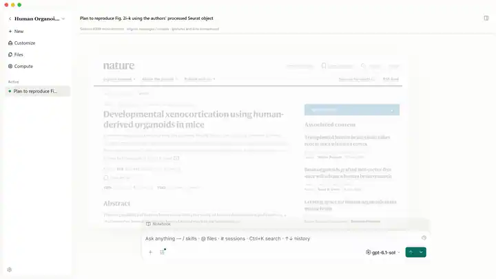

<h1 align="center">AIPOCH Open-Science</h1>

<p align="center">
  AIPOCH Open-Science 是一款面向可复现科学研究的本地优先、开源 AI 研究工作台，支持灵活选择模型。分享可移交的 <code>.science</code> 包，让他人检查结果背后的证据，也可以导出研究影片，展示得到结果的过程。
</p>

<p align="center">
  <a href="https://www.youtube.com/watch?v=to_BhE5DDMw">
    
  </a>
</p>

<p align="center">在 YouTube 观看: <a href="https://www.youtube.com/watch?v=to_BhE5DDMw">AIPOCH Open-Science: Generating .science Research Packages (Demo)</a></p>

<p align="center">
  <a href="https://aipoch.com/open-science/download">
    
  </a>
  <a href="https://github.com/aipoch/open-science/releases/latest">
    
  </a>
  <a href="https://doi.org/10.5281/zenodo.22252246">
    
  </a>
  <a href="https://arxiv.org/abs/2610.17110">
    
  </a>
  <a href="#基准测试表现">
    
  </a>
  <a href="https://github.com/aipoch/open-science/releases/latest">
    
  </a>
  <a href="../../LICENSE">
    
  </a>
  <a href="https://aipoch.com/open-science">
    
  </a>
</p>

<p align="center">
  <a href="../../README.md"></a>
  <a href="../zh-Hans/README.md"></a>
  <a href="../zh-Hant/README.md"></a>
  <a href="../ja/README.md"></a>
  <a href="../ko/README.md"></a>
  <a href="../fr/README.md"></a>
  <a href="../ru/README.md"></a>
  <a href="../de/README.md"></a>
  <a href="../es/README.md"></a>
</p>

> 本文档是英文 `README.md` 的翻译。如内容存在差异，请以[英文原文](../../README.md)为准。

### 💡 AIPOCH Open-Science v1.2.1 更新

_2026 年 11 月 11 日_

- **统一资源中心**：集中管理技能、连接器、专家及市场安装；Web 界面也支持从市场安装。
- **手动优化提示词**：从输入区调用已配置的服务商，审阅、编辑或撤销结果；自定义模板保存在项目设置中。
- **内置智能体升级**：主智能体和子智能体可使用 Codex 订阅；新增支持 1M 词元上下文的 Claude Fable 5.2，并采用服务商支持的输出上限。
- **文献 CSV 导出**：导出选中文献、整个项目或文献集的元数据，使用 16 个固定英文列名。
- **紧凑研究导出**：Notebook 和 Compute 对相同内容的证据只存储一次，缩小长篇 `.science` 记录并加快导出。
- **云端计算登录**：Modal 和 Hugging Face 在浏览器授权前准备兼容的 Python，账户验证使用系统代理。
- **可靠性改进**：改善 Windows 更新恢复、回答提问后的继续执行及切换会话时的研究影片生成；会话无活动 15 分钟后回收空闲解释器。

[查看 v1.2.1 完整版本说明](https://github.com/aipoch/open-science/releases/tag/v1.2.1)

<a id="share-your-research"></a>

## 一份可分享的研究记录，一部可观看的研究影片

用[`.science` 包](https://aipoch.com/docs/guides/research-packages/)交接研究结果。选择要分享的对话分支、文件版本、Notebook 记录和验证证据。接收者可将包导入自己的项目，打开只读记录，查看图表所用的输入。验证记录反映发送方做过的检查。在桌面端选择“创建分支以继续”可获得可编辑的副本。

用[研究影片](https://aipoch.com/docs/guides/research-films/)展示同一项工作。在桌面端对已完成的对话分支选择“生成研究影片”。配置的模型根据会话记录编写演示内容，本地语音引擎生成英文旁白。预览后可下载 HTML 播放器或导出 MP4。如果所选分支已生成影片，`.science` 包也可携带其播放器。

## 🚀 快速开始

### 1. 下载应用

打开[官方应用下载页面](https://aipoch.com/open-science/download)，并选择适合你计算机的安装程序：

| 你的计算机                              | 选择                                      |
| --------------------------------------- | ----------------------------------------- |
| macOS 12+ — Apple 芯片（M1 或更新型号） | 适用于 Apple Silicon / ARM64 的 macOS DMG |
| macOS 12+ — Intel                       | 适用于 Intel / x64 的 macOS DMG           |
| Windows 10/11 x64                       | Windows x64 安装程序（已代码签名）        |
| Linux x64                               | Linux x64 AppImage 或 Debian 软件包       |
| Linux ARM64                             | Linux ARM64 AppImage 或 Debian 软件包     |

安装前的校验方法见[验证下载](../../SECURITY.md#verifying-your-download)。

macOS 用户也可以通过 [Homebrew](https://brew.sh) 安装：

```bash
brew install --cask open-science
```

macOS 或 Linux 的独立 CLI 使用单独的 [AIPOCH tap](https://github.com/aipoch/homebrew-tap)：

```bash
brew install aipoch/tap/open-science
```

该 Formula 自带 Node，无需启动桌面应用；其版本可能与桌面 Cask 不同。前提条件与升级方式见[独立运行时指南](../standalone-runtime.md)。

也可从 [GitHub Release 的 Assets](https://github.com/aipoch/open-science/releases/latest) 下载自带 Node.js 的独立 CLI 压缩包，适用于 macOS 和 Linux（ARM64 或 x64）以及 Windows x64。

如需独立 CLI 和 Web 界面，可使用 **Node.js 22.13.0 或更高版本**安装已发布的 [npm 软件包](https://www.npmjs.com/package/@aipoch/open-science)：

```bash
npm install --global @aipoch/open-science
open-science start --no-open
open-science url
```

打开输出的 URL 完成配置，或按照[命令行配置指南](../../packages/open-science/CLI.md#first-run-setup-codex)操作。npm 支持 macOS ARM64/x64、使用 glibc 的 Linux ARM64/x64 和 Windows x64，无需安装桌面应用。请保留 npm 可选依赖，并查看 [Linux 前置条件和升级说明](../standalone-runtime.md#install-from-npm)。该 URL 包含身份验证令牌，请勿分享。

Windows 重装会保留研究数据；如需彻底清理，请参阅[数据重置工具](../../scripts/windows-reset/README.md)，确认后会永久删除本地数据。

### 2. 完成首次设置

按向导依次完成：**环境 → 数据位置 → 智能体运行时 → 模型服务商 → Notebook 运行时**。

完成必需的环境和智能体运行时检查，并测试模型连接。Python/R Notebook 配置可选；Notebook 和数据位置都可稍后在设置中调整。

首次设置完成后，可在系统设置中调整外观和通知。在通用设置中可查看应用信息、诊断和命令行工具，也能打开手动安装与更新指南。

原“模型”设置页现更名为**本地能力**，集中管理 PDF 提取、OCR 语言包和研究语音讲解；语音讲解需要本地安装的语音模型。

<table>
  <tr>
    <td width="50%"></td>
    <td width="50%"></td>
  </tr>
  <tr>
    <td align="center"><sub>主机兼容性、存储和网络检查</sub></td>
    <td align="center"><sub>服务商、API Key、端点和模型验证</sub></td>
  </tr>
</table>

### 3. 开始研究项目

1. 点击 **New project**，打开会话，说明研究目标、输入和期望输出。
2. 附加文件，选择模型与批准模式，然后发送任务；可用 `@` 引用项目文件，用 `/` 选择技能。
3. 查看工具活动并处理批准请求，预览结果，通过 **Provenance** 检查可用证据。

> 本 README 中的截图用于说明工作流程。标签、目录和其他界面细节可能与所安装版本不同。

<a id="核心能力"></a>

## 用 AIPOCH Open-Science 可以做什么？

| 任务         | 工作方式                                                                                    |
| ------------ | ------------------------------------------------------------------------------------------- |
| 审阅文献     | 从 Zotero 导入文献，按自己的标准筛选论文，打开原文 PDF 核对发现。                           |
| 分析数据     | 在 Notebook 中运行 Python 或 R，将输出的图表与源文件对照查看。                              |
| 追溯结果     | 在溯源视图中查看某个文件版本的输入、代码及执行历史。配方、输入和运行环境齐备时可以重跑。    |
| 交接结果     | 分享[`.science` 包](#share-your-research)，让他人检查结果背后的步骤和文件版本。             |
| 扩展工作流程 | 启用科学数据连接器，选择内置技能，或从市场安装其他技能和专家。                              |
| 选择模型     | 连接支持的服务商、自定义网关，或使用支持的 Claude 或 Codex 订阅。可用协议取决于智能体后端。 |

<a id="基准测试表现"></a>

## 基准测试结果

AIPOCH 对 AIPOCH Open-Science 进行了评测，任务涵盖查找论文、回答论文内容相关问题和执行研究计划。以下结果来自 AIPOCH 自行开展的测试，每项成绩对应特定任务与评测配置。 评测还覆盖计算复现和基于数据的假设发现。

| 任务             | Benchmark              | AIPOCH Open-Science 的结果                                                                                                                  |
| ---------------- | ---------------------- | ------------------------------------------------------------------------------------------------------------------------------------------- |
| 找到目标论文     | LitQA2-FullText-Search | 在 LitQA2-FullText-Search 的 **75 道测试题中，有 68 道的目标论文出现在前 30 条结果中**（**Recall@30 为 90.67%**，gpt-6-astra）。            |
| 根据文献回答问题 | LitQA2-FullText        | 在独立的 LitQA2-FullText 测试中，Open-Science **答对 75 题中的 70 题**（**准确率 93.33%**，deepseek-flash，Max 推理）。                     |
| 综合带引用的答案 | ScholarQA-CS2          | 使用 deepseek-v4-flash，在 ScholarQA-CS2 的 100 道验证题上获得 **0.9289/1 的综合质量分数**。官方测试参考结果使用不同的题目。                |
| 执行研究流程     | ASI-Bench              | 在使用相同模型的本地 ASI-Bench 测试中，Open-Science 的 B4 得分为 **59.46**，Codex 为 **55.45**。B2 得分几乎相同（**56.11** 与 **56.09**）。 |
| 分析生物医学数据 | BiomniBench-DA         | 在 BiomniBench-DA Public 50 上，两位评审模型的评分分别为 **81.04** 和 **77.06**，等权平均为 **79.05**。                                     |
| 复现已发表的结果 | CORE-Bench-Hard        | CORE-Bench-Hard — 本地评测答对 37 项测试任务中的 36 项（97.30%），最终统计包含复测。                                                        |
| 根据数据提出假设 | DiscoveryBench         | DiscoveryBench — 在验证集的 25 项任务上，本地模型评分的均值为 0.7467/1。                                                                    |

<details>
<summary>评测范围与报告</summary>

**评测范围：** 报告涵盖 2026 年 8 月至 11 月、使用所列模型与数据划分开展的本地或内部测试，并未针对当前版本重新运行。参考成绩是历史快照，并非实时排名。不同基准系列的分数不能直接比较，数值差距不代表统计显著性。

评测详情见 [AstaBench 与 ASI-Bench 报告](https://aipoch.com/benchmark/open-science)及 [BiomniBench-DA 报告](https://aipoch.com/blog/open-science-biomnibench-da)。

[CORE-Bench-Hard · 复现评测报告](https://aipoch.com/blog/aipoch-open-science-core-bench-hard)

</details>

## 数据、权限与信任

AIPOCH Open-Science 将项目数据、设置、产物版本和来源证据存储在本地计算机上。API Key 保存在本地，并在操作系统支持时使用其安全凭据存储。日志保存在本地，不会自动上传。

仍可能发生外部数据流，应对其进行审查：

- 模型请求会将提示和必要上下文发送给所选模型服务商。
- 网页搜索和远程连接器会将其显示的参数发送给外部服务。
- 本地连接器可能会在计算机上执行受信任命令。
- 应用也可能访问更新服务器、市场目录，以及运行时或模型下载服务。
- 附件、`@` 引用、日志和生成报告可能包含敏感研究数据。

选择能够满足任务需要的最小权限配置：

| 模式                 | 行为                                                           | 建议用途                             |
| -------------------- | -------------------------------------------------------------- | ------------------------------------ |
| `Ask for approval`   | 对未被已有范围授权或可信应用工具策略覆盖的操作请求批准         | 新工作流、敏感数据、不熟悉的脚本     |
| `Auto-approve edits` | 优先使用后端原生自动审查；否则仅自动批准明显低风险的工作区操作 | 受信任的文件编辑工作，并控制外部访问 |
| `Full access`        | 自动允许编辑、命令、网络和连接器                               | 范围清晰、完全受信任的无人值守工作   |

实际权限模式取决于所选后端和已有授权。连接器、工具及计算网络策略同样适用；请查看应用显示的实际生效模式。

批准前检查连接器参数和工具活动。切勿在截图或公开问题日志中包含 API Key、访问令牌、患者标识符、未公开数据或敏感本地路径。

## 开发者指南

- **开发** · [从源码构建与打包](../development-quick-reference.md) · [参与贡献](../../CONTRIBUTING.md)
- **运行 Open-Science** · [独立运行环境](../standalone-runtime.md) · [服务生命周期](../../packages/open-science/CLI.md#service-lifecycle) · [移动设备配对](https://aipoch.com/docs/guides/remote-access/#mobile-pairing)
- **自动化** · [CLI](../../packages/open-science/CLI.md) · [Node.js SDK](../../packages/open-science/README.md) · [连接 MCP 客户端](../../packages/open-science/CLI.md#external-agents-through-mcp)

## 常见问题

<a id="为什么模型连接测试失败"></a>

<details>
<summary>为什么模型连接测试失败？</summary>

答：检查 API Key 是否缺少字符或含有空格，验证 Base URL 和地区，使用服务商准确的模型 ID，并确认网络访问和账户余额。对于 Claude 订阅，根据所选模式重新尝试共享浏览器登录，或刷新隔离的 `claude setup-token` 凭据。

</details>

<a id="为什么设置期间-continue-被禁用"></a>

<details>
<summary>为什么设置期间 <code>Continue</code> 被禁用？</summary>

答：当前步骤尚未满足必需条件。根据活动步骤，修复标记为 `Action needed` 的环境行，安装或修复所选智能体运行时，或验证模型服务商。Notebook 设置是可选的，只影响 Notebook 执行。

</details>

<a id="如何在远程-hpc-集群上运行任务"></a>

<details>
<summary>如何在远程 HPC 集群上运行任务？</summary>

答：**Remote Compute (SSH)** 始终启用，无需在 Settings 中手动启用。先在 **Settings → Connections → Compute** 中注册 SSH 计算主机并使其对当前会话可用，然后通过自然语言或 `/remote-compute-ssh` 使用远程计算。你需要可访问的 SSH 主机、有效认证、所需目录的访问权限，以及任务所需的软件、依赖和计算资源。Direct SSH 不要求调度器；Slurm 模式要求可用的 Slurm 环境和作业提交权限。“始终启用”仅指该 Skill，不代表所有已注册主机始终可用。

自行连接的 Kubernetes、Hugging Face Jobs、Modal 和 Ray 目标也受支持。每次外部提交前需批准目标、命令、资源和输出；恢复记录可在重启后继续收集结果，已发布结果可从 Compute Preview 打开。需自行准备账户、软件、资源和权限，云端任务可能产生费用。

</details>

<a id="是否提供命令行界面"></a>

<details>
<summary>是否提供命令行界面？</summary>

答：支持。安装独立 CLI，或使用 **设置 → 通用 → 命令行工具 → 安装命令** 控制已经运行的桌面实例。通过 npm 安装需要 Node.js；Homebrew 和自带运行时的独立发行包已包含 Node.js。初始化本地配置后，无需打开浏览器即可控制服务并提交科研任务：

```bash
# 在后台启动服务
open-science init
open-science start --no-open

# 新建项目，并按准确名称运行任务
open-science project create "Systematic review"
open-science run --project "Systematic review" \
  --prompt-file ./task.md \
  --approval-profile auto \
  --skill literature-review \
  --wait --json

# 下载生成产物
open-science artifacts list <session-id> --json
open-science artifacts download <artifact-id> --output ./report.md
```

完整命令参考、JSON/JSONL 输出格式、退出码和无界面服务选项请查看 [CLI 指南](../../packages/open-science/CLI.md)。

</details>

<a id="如何检查生成结果的来源"></a>

<details>
<summary>如何检查生成结果的来源？</summary>

答：打开生成产物并选择 **Provenance**。选择一个版本，以检查内容标识及可用的生成代码、执行历史、输入、环境清单、生成对话上下文和审查证据。AIPOCH Open-Science 无法验证的证据会标记为不可用。

</details>

<a id="能否修改较早的请求而不丢失后续对话"></a>

<details>
<summary>能否修改较早的请求而不丢失后续对话？</summary>

答：可以。编辑已完成的用户消息并重新发送，从该位置新建分支。原有后续轮次仍然可用，消息旁的修订箭头可在不同路径之间切换。

</details>

## 贡献者

感谢所有为 AIPOCH Open-Science 贡献代码、文档、翻译、缺陷报告和社区支持的朋友。

[查看 GitHub 贡献者](https://github.com/aipoch/open-science/graphs/contributors)

[](https://github.com/aipoch/open-science/graphs/contributors)

## 参与项目

通过报告问题、建议功能、提问或贡献内容，一起改进 AIPOCH Open-Science。选择下方适合的渠道开始参与。

| 渠道                                                                     | 用途                               |
| ------------------------------------------------------------------------ | ---------------------------------- |
| [GitHub Issues](https://github.com/aipoch/open-science/issues)           | 缺陷、可复现故障和具体功能建议     |
| [GitHub Discussions](https://github.com/aipoch/open-science/discussions) | 设计问题、路线图提议和较长技术讨论 |
| [Discord](https://discord.gg/zxQAYjReRv)                                 | 社区帮助、贡献者协调和非正式讨论   |
| [X / @aipoch_ai](https://x.com/aipoch_ai)                                | 版本公告和公开构建动态             |
| [AIPOCH Open-Science 官网](https://aipoch.com/open-science)              | 官方产品概览与下载                 |

提交公开问题前，从日志和截图中移除 API Key、令牌、私有文件路径、未公开数据、患者标识符和其他敏感材料。开发工作流请参阅[贡献指南](../../CONTRIBUTING.md)。

> 如果 AIPOCH Open-Science 对你有帮助，欢迎在 GitHub 上为仓库 Star。

已交付、部分实现和计划能力见[能力地图](../ROADMAP.md#capability-map)。

<a id="aipoch-open-science-论文与引用"></a>

## 引用

如果你的研究使用了 AIPOCH Open-Science，请引用[AIPOCH Open-Science 预印本](https://arxiv.org/abs/2610.17110)。

<details>
<summary>BibTeX 引用</summary>

```bibtex
@misc{ouyang2026aipochopenscienceopensourceai,
      title={AIPOCH Open-Science: An Open-Source AI Research Workbench with Reproducible .science Packages},
      author={Wen Ouyang and Bocheng Huang and Qianyu Yao and Fei Sun and Minying Deng and Haoyue Cheng and Wenwen Zhou and Lei Mou and Yusi Wei and Jiang Li and Kun Zhu and Lei Wang and Yi Feng and Jiaheng Dai and Ke Qian and Dan Wang and Yahui Wang and Chenyi Wang and Mingsheng Lyu and Yaqiang Zhang and Ping Zheng and Chunhua Tang and Xinge Ma and Xu Zhang and Youjia Fan and Can Lu and Zhijun Dai and Man Hu and Qiqi Xie and Beinan Liu and Yuanning Guo and Yunze Liu and Jinhong Jiang and Xianjun Fu and Mingwei Zhang and Yuanji Xu and Shilin Xia and Bowen Yang and Mingjun Yu and Jingdun Xie and Xuwei Chen and Xia Zou and Yuzhou Xue and Jianguo Zhou and Chunhao Cao and Donghao Tian and Lei Huang and Jinxiao Li and Shengrong Long and Zefeng Song and Honglin Li and Jiang Luo and Wenying Jiang and Shanshan Li and Lei Dai and Ning Jiang and Ying Cai and Chaohui Li and Chunyan Peng and Hetong Zhao and Angqing Li and Chunyan Yang and Chongyang Sun and Yong Li and Xinyu Shi and Wei Dai and Ming Peng and Chen Sang and Yuanyuan Han and Desong Qiu and Haixin Miao and Jian Xu and Yi Chen and Xiaoliang Shi and Tian Shen and Teng Hu and Shuhao Wang and Yingyong Hou and Huimei Wang},
      year={2026},
      eprint={2610.17110},
      archivePrefix={arXiv},
      primaryClass={cs.SE},
      url={https://arxiv.org/abs/2610.17110},
}
```

</details>

## 许可证

Apache License 2.0 — 参阅 [LICENSE](../../LICENSE)。
