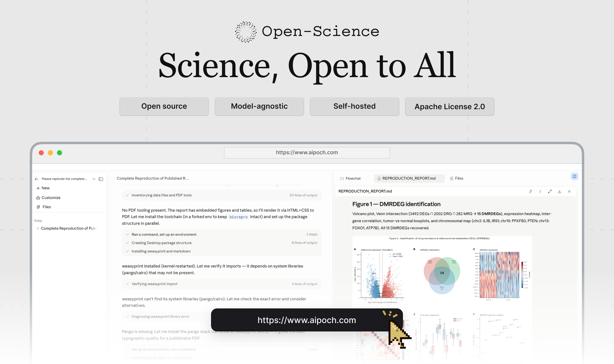
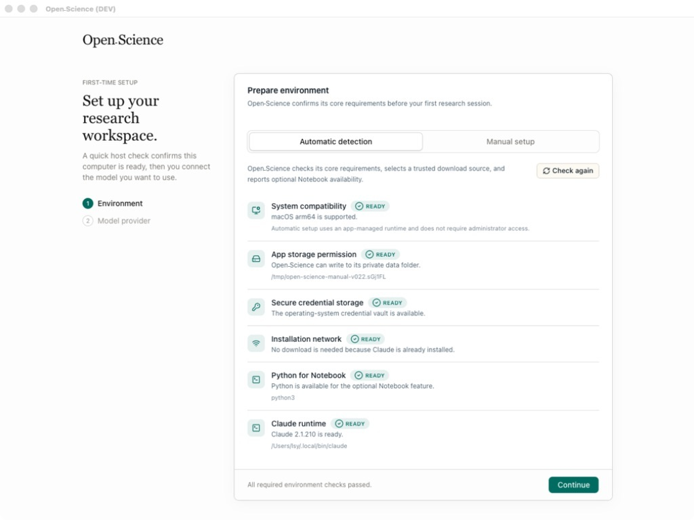
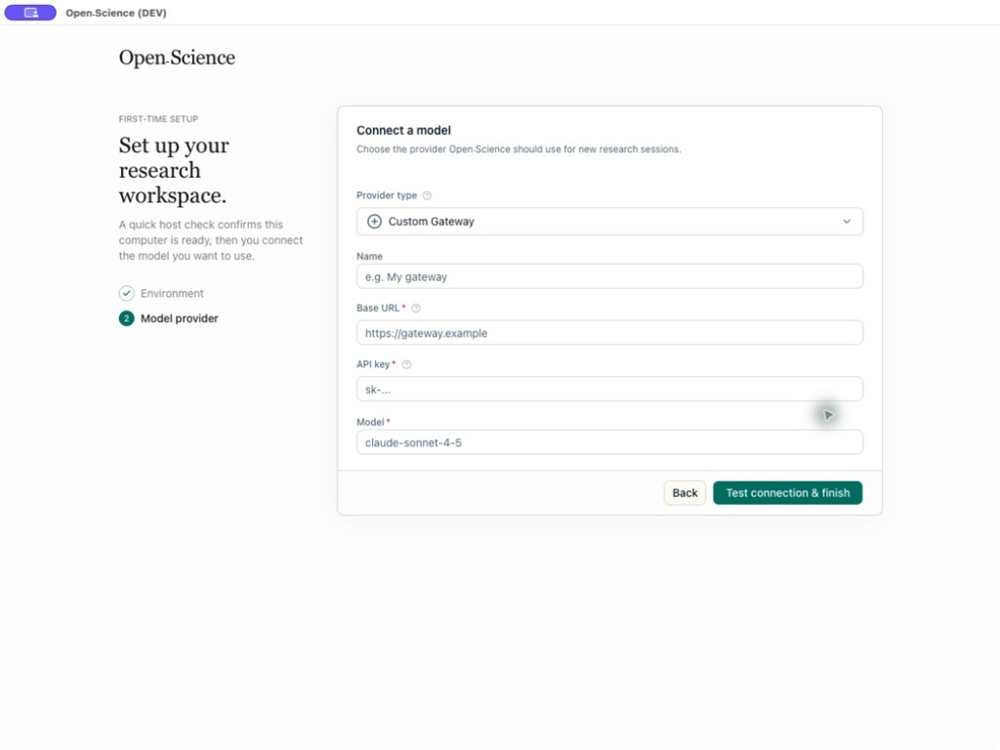
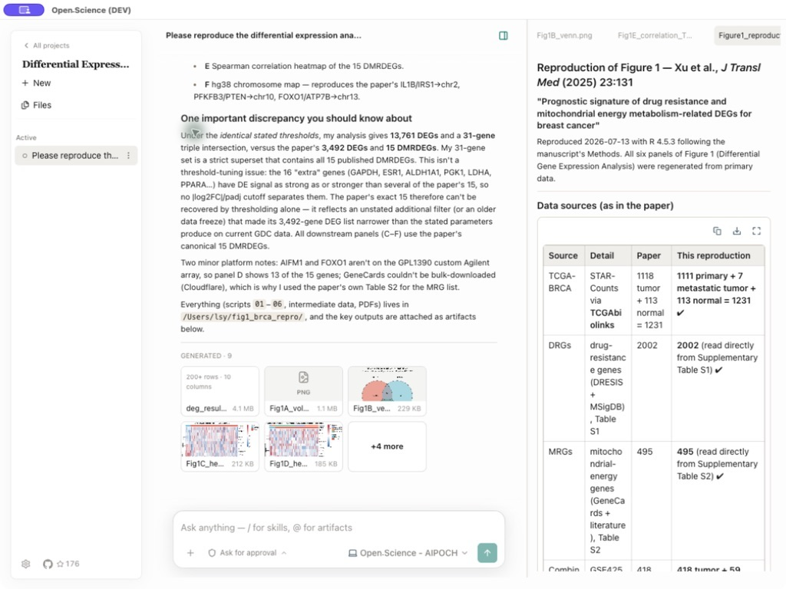
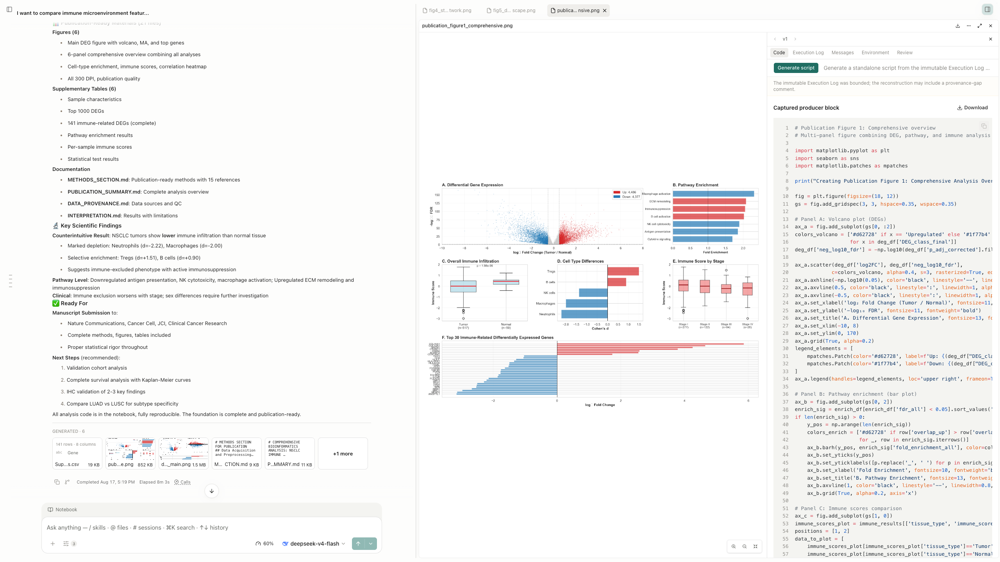
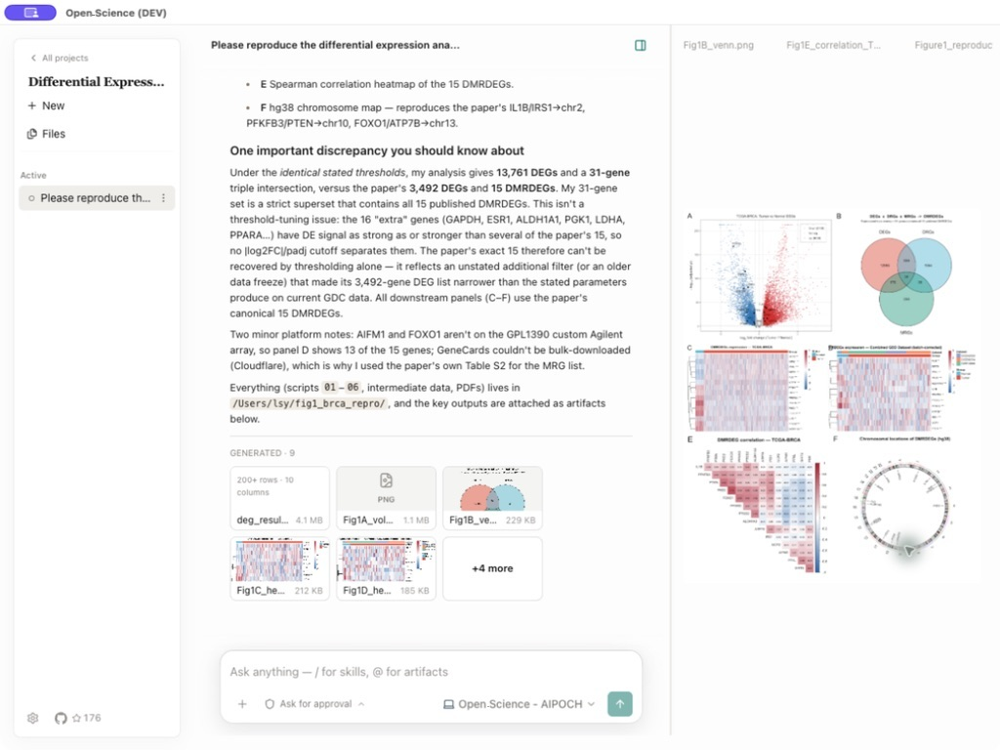
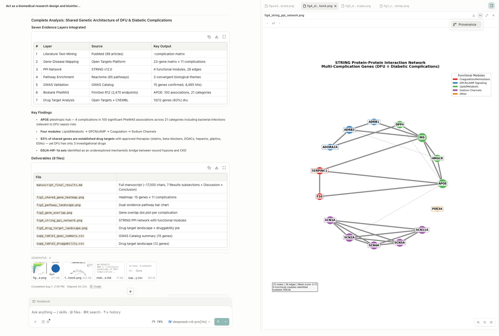
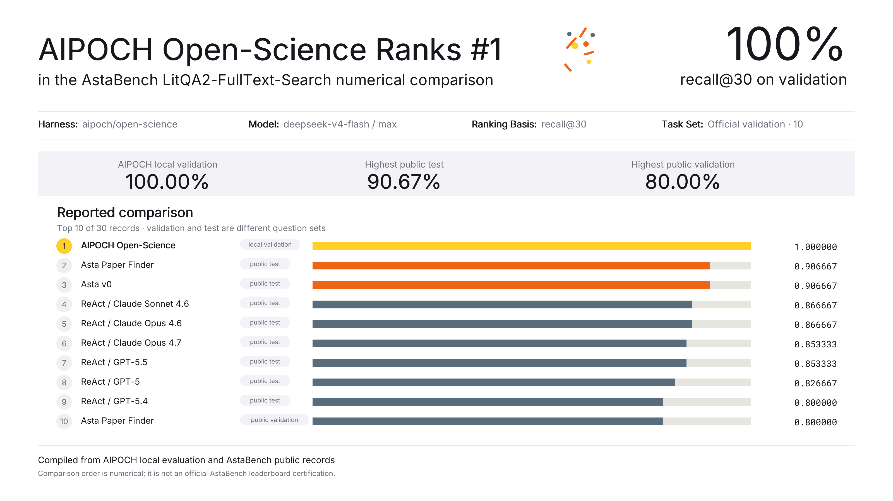
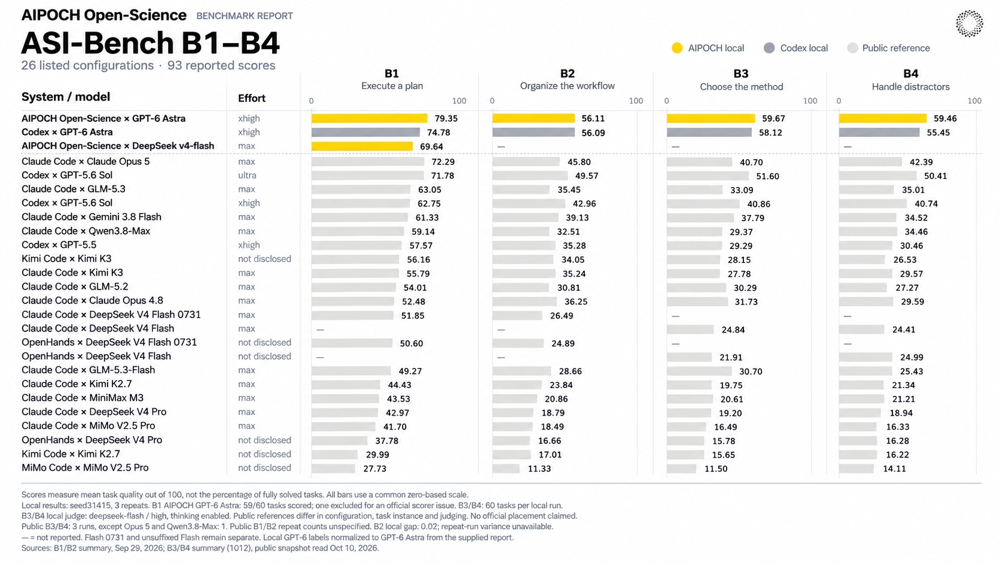
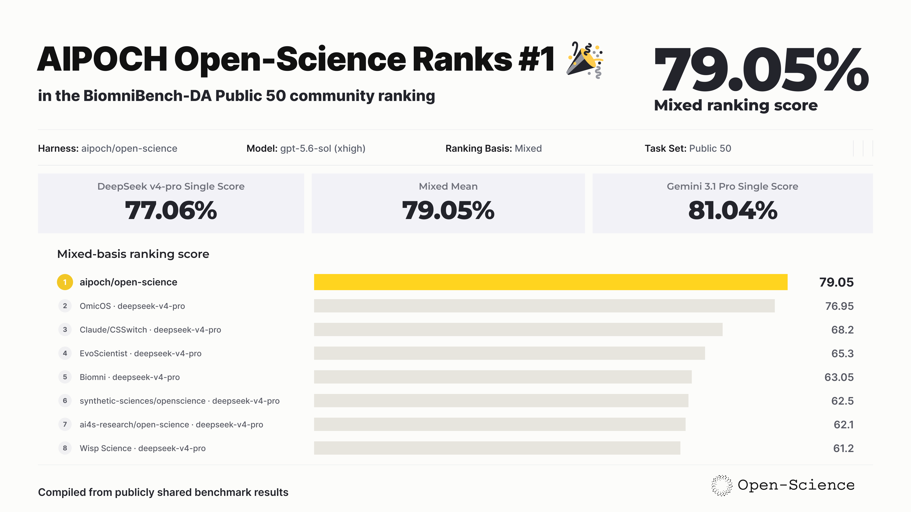

<h1 align="center">AIPOCH Open-Science</h1>

<p align="center">
  面向可复现科学研究的 AI 研究工作台——开源、本地优先、模型无关。
</p>

<p align="center">
  <a href="https://aipoch.com/open-science/download">
    
  </a>
  <a href="https://github.com/aipoch/open-science/releases/latest">
    
  </a>
  <a href="https://doi.org/10.5281/zenodo.22252246">
    
  </a>
  <a href="https://arxiv.org/abs/2610.17110">
    
  </a>
  <a href="#基准测试表现">
    
  </a>
  <a href="https://github.com/aipoch/open-science/releases/latest">
    
  </a>
  <a href="../../LICENSE">
    
  </a>
  <a href="https://aipoch.com/open-science">
    
  </a>
</p>

<p align="center">
  <a href="../../README.md"></a>
  <a href="../zh-Hans/README.md"></a>
  <a href="../zh-Hant/README.md"></a>
  <a href="../ja/README.md"></a>
  <a href="../ko/README.md"></a>
  <a href="../fr/README.md"></a>
  <a href="../ru/README.md"></a>
  <a href="../de/README.md"></a>
  <a href="../es/README.md"></a>
</p>

> 本文档是英文 `README.md` 的翻译。如内容存在差异，请以[英文原文](../../README.md)为准。

AIPOCH Open-Science 是面向科学家和研究人员的 AI 研究工作台，由 [AIPOCH](https://aipoch.com/open-science) 开发，采用开源、本地优先、模型无关的设计。它通过科学 AI 智能体、Python 和 R 执行、科学数据连接器以及对 macOS、Windows 和 Linux 的跨平台支持，实现可复现、可检查的研究。在同一个工作区中，新建项目，用自然语言描述研究目标，然后让智能体读取文件、搜索网页、运行代码、查询科学数据源，并生成带有可追溯来源的报告、表格和图表。

AIPOCH Open-Science 支持机器学习、统计学、生命科学、化学、材料科学、物理学和环境科学等领域的计算密集型与数据密集型研究。它覆盖从文献综述、假设构建到代码执行、数据分析、仿真、可视化以及生成可追溯研究成果的完整研究流程。

已完成的研究会话还可以导出为可移植的 `.science` 包，用于审阅、交接和归档，并携带所选的对话分支、文件版本、Notebook 记录和验证证据。

> 💡 **AIPOCH Open-Science v1.0.1** _（2026 年 10 月更新）_。本次补丁新增从浏览器一键导入 `.science` 包、更清晰可靠的站内更新（尤其是 Windows）、始终可见的会话等待状态、MCP OAuth 凭据处理的安全修复，以及一批 PDF、文献和会话包修复。详情请查看 [1.0.1 发行说明](../../release-notes/1.0.1/zh-Hans.md)。下载仍以[最新已发布版本](https://github.com/aipoch/open-science/releases/latest)为准。

<p align="center">
 
</p>

## 目录

- [快速开始](#-快速开始)
- [产品导览](#产品导览)
- [AIPOCH Open-Science `.science` 包](#aipoch-open-science-science-包)
- [AIPOCH Open-Science 论文与引用](#aipoch-open-science-论文与引用)
- [基准测试表现](#基准测试表现)
- [核心能力](#核心能力)
- [模型服务商](#模型服务商)
- [数据、权限与信任](#数据权限与信任)
- [开发与打包](#开发与打包)
- [常见问题](#常见问题)
- [参与项目](#参与项目)
- [许可证](#许可证)

## 🚀 快速开始

### 1. 下载应用

打开[官方应用下载页面](https://aipoch.com/open-science/download)，并选择适合你计算机的安装程序：

| 你的计算机                              | 选择                                      |
| --------------------------------------- | ----------------------------------------- |
| macOS 12+ — Apple 芯片（M1 或更新型号） | 适用于 Apple Silicon / ARM64 的 macOS DMG |
| macOS 12+ — Intel                       | 适用于 Intel / x64 的 macOS DMG           |
| Windows x64                             | Windows x64 安装程序（已代码签名）        |
| Linux x64                               | Linux x64 AppImage 或 Debian 软件包       |
| Linux ARM64                             | Linux ARM64 AppImage 或 Debian 软件包     |

从[官方应用下载页面](https://aipoch.com/open-science/download)下载安装包；如需校验，请参阅[验证下载](../../SECURITY.md#verifying-your-download)。

macOS 用户也可以通过 [Homebrew](https://brew.sh) 安装：

```bash
brew install --cask open-science
```

macOS 或 Linux 的独立 CLI 使用单独的 [AIPOCH tap](https://github.com/aipoch/homebrew-tap)：

```bash
brew install aipoch/tap/open-science
```

该 Formula 自带 Node，无需启动桌面应用；其版本可能与桌面 Cask 不同。前提条件与升级方式见[独立运行时指南](../standalone-runtime.md)。

Windows 重装会保留研究数据；如需彻底清理，请参阅[数据重置工具](../../scripts/windows-reset/README.md)，确认后会永久删除本地数据。

### 2. 完成首次设置

按向导依次完成：**环境 → 数据位置 → 智能体运行时 → 模型服务商 → Notebook 运行时**。

完成必需的环境和智能体运行时检查，并测试模型连接。Python/R Notebook 配置可选；Notebook 和数据位置都可稍后在设置中调整。

<table>
  <tr>
    <td width="50%"></td>
    <td width="50%"></td>
  </tr>
  <tr>
    <td align="center"><sub>主机兼容性、存储和网络检查</sub></td>
    <td align="center"><sub>服务商、API Key、端点和模型验证</sub></td>
  </tr>
</table>

### 3. 开始研究项目

1. 点击 **New project**，打开会话，说明研究目标、输入和期望输出。
2. 附加文件，选择模型与批准模式，然后发送任务；可用 `@` 引用项目文件，用 `/` 选择技能。
3. 查看工具活动并处理批准请求，预览结果，通过 **Provenance** 检查可用证据。

> 本 README 中的截图用于说明工作流程。标签、目录和其他界面细节可能与所安装版本不同。

## 产品导览

### 从研究请求到可追溯结果

以一个具有代表性的生物信息学任务为例：复现已发表的差异表达分析，将重新生成的结果与论文比较，并交付审阅所需的报告、表格和图像。以下截图来自已记录的 AIPOCH Open-Science 工作流，用于展示各个阶段，并非同一次连续会话。

#### 1. 明确研究任务与证据

说明研究问题、来源论文与数据集、必需的方法或阈值、预期输出和验收标准。上传支持文件，或使用 `@` 引用已有项目产物，让智能体从明确的输入开始，而不是依赖隐藏上下文。

<p align="center">
  
</p>

#### 2. 使用可检查的科学工具执行

智能体可以在共享 Notebook 中组合科学技能、受权限控制的研究连接器、搜索、文件操作以及 Python 或 R 代码。生成图像可与研究摘要并排审阅，产物记录则提供已捕获的生成代码和执行证据供检查。

<p align="center">
  
</p>

#### 3. 就地审阅报告、表格和图像

最终回答会概述哪些结果成功复现、哪些存在差异，以及需要关注的局限。生成的 Markdown 报告、CSV 表格、图像和其他研究产物会继续附属于会话，并汇集到项目文件库，可在对话旁预览，也可用于后续工作。

<p align="center">
  
</p>

#### 4. 将每个产物追溯到证据

每个生成产物都以不可变且带校验和的版本保存。其 **Provenance** 视图可显示生成代码与执行历史、引用的输入、观测到的环境清单、生成该产物的对话分支，以及限定到该版本的 Reviewer 结果。无法验证的证据会标记为不可用，而不会被推断补全。

<p align="center">
  
</p>

## AIPOCH Open-Science `.science` 包

将已完成的研究会话导出为可移植的 `.science` 包，用于审阅、交接和归档。选择要纳入的对话分支、文件版本、Notebook 记录和验证证据，然后将包导入其他项目或计算机。

**导出 → 传递 → 检查**

1. 导出已完成的会话，并选择要纳入的内容。
2. 将 `.science` 文件传递给协作者，或转移到另一台计算机。
3. 将它导入项目。右侧的 **Research replay** 展示记录过程，左侧对话可针对记录提问并引用固定步骤。

导入记录保持只读；浏览回放不会执行代码、调用模型或恢复凭据。首次提问会创建关联的可写讨论；使用 **Create a copy to continue research** 创建副本后可继续研究。重新运行结果仍需要完整配方、必要输入和可用运行环境。

Side Chat 对话、私人阅读书签和凭据不随包导出，所含文件取决于导出选择。收到的验证记录描述发送方执行过的检查，不代表接收计算机已重新运行。详见 [`.science` 包指南](https://aipoch.com/docs/guides/research-packages/)。

## AIPOCH Open-Science 论文与引用

**[AIPOCH Open-Science: An Open-Source AI Research Workbench with Reproducible .science Packages](https://arxiv.org/abs/2610.17110)**

arXiv 预印本 · [v1](https://arxiv.org/abs/2610.17110v1) · 提交于 2026 年 10 月 12 日。

我们的预印本介绍了 AIPOCH Open-Science：一个开源 AI 科研工作台，通过可移植的 `.science` 包共享研究上下文、产物版本和验证记录。阅读论文，了解包交换设计与受控评估。

如果在研究中使用 AIPOCH Open-Science，可引用这篇预印本：

<details>
<summary>BibTeX 引用</summary>

```bibtex
@misc{ouyang2026aipochopenscienceopensourceai,
      title={AIPOCH Open-Science: An Open-Source AI Research Workbench with Reproducible .science Packages},
      author={Wen Ouyang and Bocheng Huang and Qianyu Yao and Fei Sun and Minying Deng and Haoyue Cheng and Wenwen Zhou and Lei Mou and Yusi Wei and Jiang Li and Kun Zhu and Lei Wang and Yi Feng and Jiaheng Dai and Ke Qian and Dan Wang and Yahui Wang and Chenyi Wang and Mingsheng Lyu and Yaqiang Zhang and Ping Zheng and Chunhua Tang and Xinge Ma and Xu Zhang and Youjia Fan and Can Lu and Zhijun Dai and Man Hu and Qiqi Xie and Beinan Liu and Yuanning Guo and Yunze Liu and Jinhong Jiang and Xianjun Fu and Mingwei Zhang and Yuanji Xu and Shilin Xia and Bowen Yang and Mingjun Yu and Jingdun Xie and Xuwei Chen and Xia Zou and Yuzhou Xue and Jianguo Zhou and Chunhao Cao and Donghao Tian and Lei Huang and Jinxiao Li and Shengrong Long and Zefeng Song and Honglin Li and Jiang Luo and Wenying Jiang and Shanshan Li and Lei Dai and Ning Jiang and Ying Cai and Chaohui Li and Chunyan Peng and Hetong Zhao and Angqing Li and Chunyan Yang and Chongyang Sun and Yong Li and Xinyu Shi and Wei Dai and Ming Peng and Chen Sang and Yuanyuan Han and Desong Qiu and Haixin Miao and Jian Xu and Yi Chen and Xiaoliang Shi and Tian Shen and Teng Hu and Shuhao Wang and Yingyong Hou and Huimei Wang},
      year={2026},
      eprint={2610.17110},
      archivePrefix={arXiv},
      primaryClass={cs.SE},
      url={https://arxiv.org/abs/2610.17110},
}
```

</details>

## 基准测试表现

以下为 2026 年 8—10 月报告的历史成绩，不是针对 v1.0.0 进行的新评测。

来源报告: [9 月 29 日](https://hwtgofuh6ud.feishu.cn/wiki/Kl5cwupToi901BkEaQacM1V2n7e), [10 月 12 日](https://hwtgofuh6ud.feishu.cn/wiki/XZSbw7L87ibjQUk98qJcuqFUnKh) (可能需要访问权限).

### 🏆 AstaBench LitQA2-FullText-Search：10/10全部命中

AIPOCH Open-Science 使用 **DeepSeek v4-flash（max）**，结合文献检索专家与技能，在官方10题验证集上取得 **100% recall@30**：每道题所需的目标论文均出现在返回结果的前30篇中。该成绩高于报告所列的3条公开验证集成绩，较其中最高的 **80%高20个百分点**。本次报告记录了3次本地重复测试，展示了系统在这组科研问题中的文献定位能力。



图中同时列出test与validation记录，排序仅为数值对照；100%指论文检索命中率，不是科学问答正确率。

### 🏆 ASI-Bench B1–B4：四项测试成绩均居所列对照首位

AIPOCH Open-Science 使用 **GPT-6（gpt-6-astra / xhigh）**，结合领域专家与技能，在 ASI-Bench B1、B2、B3、B4 四项测试中分别取得 **79.35、56.11、59.67和59.46分**，均为报告所列对照中的最高展示分数。四个档位依次考察**执行完整科研方案、组织研究流程、自主选择方法，以及在干扰信息下完成自主研究**，覆盖从方法实现到自主科研执行的不同任务条件。

同模型、同名推理强度的本地 Codex 对照分别为74.78、56.09、58.12和55.45分，我方数值分别高 **4.57、0.02、1.55和4.01分**。B1、B2报告完成3次本地重复测试；B3、B4均为每轮60题、3次本地测试的均值。



本地测试采用seed31415；B1有效计分59项，1项因报告所述评分器异常排除。B3/B4采用v0.32.0及替代裁判。公开参照的任务实例、配置和裁判条件不同；B2的0.02分仅为数值差异。

### 🏆 BiomniBench-DA Public 50：所列对照第1，79.05分

AIPOCH Open-Science 使用 **gpt-5.6-sol（xhigh）**，在标记为 BiomniBench-DA Public 50 的50项生物医学数据分析任务内部评测中取得 **79.05分**，为所汇总对照中的最高展示分数。成绩由 Gemini 3.1 Pro 裁判的 **81.04分**与 DeepSeek v4-pro 裁判的 **77.06分**等权平均得到，反映该配置在生物医学数据分析过程中的综合表现。详见[评测报告](https://aipoch.com/blog/open-science-biomnibench-da)。



该对照混合了不同裁判覆盖的记录，不能视为统一裁判条件下的正式排名。

**评测说明：**以上为自行报告的本地或内部成绩，所列对照首位不代表官方榜单第一名，也不代表已通过统计检验确认提升。

## 核心能力

AIPOCH Open-Science 在一个本地工作区中整合项目管理、多模型智能体执行、Python 和 R Notebook、科学数据连接器、带来源的不可变产物版本，以及受权限控制的人工参与机制。不断变化的目录、打包细节和新增选项应以已安装应用及[最新发行说明](https://github.com/aipoch/open-science/releases/latest)为准。

| 领域                           | 核心能力                                                                                                                                                                                                                                                                |
| ------------------------------ | ----------------------------------------------------------------------------------------------------------------------------------------------------------------------------------------------------------------------------------------------------------------------- |
| **科学技能**                   | 提供 **23 个内置技能**，并可从 [Skills Marketplace](https://github.com/aipoch/openscience-skill-marketplace) 安装 **525 个技能**，支持一键安装与更新。可通过对话或已完成的工作创建技能，导入技能包及 GitHub 来源。市场投稿经审核后发布，本地导入不会自动上架。          |
| **连接器**                     | 通过 **36 个内置连接器** 访问科学资源，也可添加自定义本地或远程 MCP 连接器。支持工具级权限管理，以及连接器配置的导入和导出。                                                                                                                                            |
| **专家与委派**                 | 从 [Specialist Marketplace](https://github.com/aipoch/openscience-specialist-marketplace) 安装 **10 个专家**，或创建和定制个人专家，由主智能体委派任务。专家包支持导入和导出；市场投稿经审核后发布，本地导入不会自动上架。                                              |
| **模型与智能体后端**           | 连接云端模型、兼容的自定义网关，或使用 Claude、Codex 订阅登录。支持 Claude Code、OpenCode、Codex 和 CodeBuddy 四种智能体后端，并提供模型连接检查、图片输入和推理强度设置。                                                                                              |
| **项目、会话与 `.science` 包** | 管理项目，支持会话置顶、消息分支、侧边对话和历史恢复。将会话导出为**可移植的 `.science` 包**，并导入其他项目或计算机，携带对话分支、所选文件版本、Notebook 记录和验证证据。导入结果为只读历史，不执行代码或恢复凭据；侧边对话和书签不随包导出，文件范围取决于导出选择。 |
| **审阅智能体**                 | 按需开启自动审阅，在独立上下文中核对智能体已完成轮次的回复、执行记录及相关文件证据。生成带依据的通过、警告或失败检查项，发现问题后可触发主智能体修正，并在有限轮次内复审。保留审阅日志与问题处理状态，审阅范围限于该轮可用记录。                                        |
| **Python、R、Notebook 与 HPC** | 使用托管环境或自配解释器，在本地运行 Python、R、Notebook 和 Shell 任务，支持后台执行与历史记录。也可通过 SSH 连接远程主机或使用 Slurm 提交作业；远程计算需具备下方 FAQ 所述的主机、软件、资源和权限。                                                                   |
| **文献库**                     | 导入和管理文献与 PDF，支持合集、标签、项目关联、笔记及重复条目合并。查找开放获取全文，阅读 PDF 并提取图表，在会话中调用库内文献辅助分析。按所选引用样式生成参考文献，并导出为 BibTeX 或 RIS。                                                                           |
| **科学文件与预览**             | 单个上传文件最大 **10 GiB**，支持项目文件管理及科学数据、PDF、Office 文档、图像、代码和分子结构预览。这是上传大小限制，不代表模型可以读取全部内容；模型上下文、附件解析和预览各有限制。大文件通常需要通过代码分块读取或分析。                                           |
| **产物与溯源**                 | 保存不可变的产物版本及可用的生成代码、输入、执行历史、环境信息和审阅证据。在桌面端，可使用完整执行配方、必要输入和可用运行时重放符合条件的版本，比较输出并导出验证记录。证据缺失可能阻止验证，重放检查不证明科学结论有效。                                              |

支持持久化 PDF 批注与文档笔记。配置筛选模型后，智能合集可按纳入／排除标准评估文献；AI 判断与人工判断分别记录，用于辅助人工审阅。

桌面端还可将产物溯源导出为 RO-Crate 1.1。与版本绑定的环境包只有在捕获内容完整且兼容目标平台时，才能用于创建托管环境；这不等于完整计算机备份。

## 模型服务商

AIPOCH Open-Science 在产品层面不限定模型：可连接主要云端 LLM 服务商、自定义网关，或复用现有 Claude、Codex 订阅。当前可用服务商取决于所选智能体后端及其支持的 API 协议。可使用以下连接方式：

| 服务商模式           | 工作方式                                                                                                                                                                                                                                                                                                             |
| -------------------- | -------------------------------------------------------------------------------------------------------------------------------------------------------------------------------------------------------------------------------------------------------------------------------------------------------------------- |
| **内置云服务商**     | 从已安装应用显示的服务商列表中选择，并使用要求的密钥进行认证。                                                                                                                                                                                                                                                       |
| **自定义网关**       | 提供 Base URL 和准确模型 ID，选择智能体后端支持的 API 协议（Messages、Chat Completions 或 Responses），然后执行连接测试。远程网关要求 HTTPS 和 API Key；`localhost`、`127.0.0.1` 或 `[::1]` 等回环端点可以使用 HTTP 并省略密钥。预设包括 Ollama、LM Studio、llama.cpp 和 vLLM。默认 API 格式不保证服务器或模型兼容。 |
| **Codex 订阅**       | 选择 Codex 智能体框架，然后在服务商类型中选择 Codex 订阅。                                                                                                                                                                                                                                                           |
| **Claude 订阅**      | 通过两种模式登录 Claude 订阅：**共享**（浏览器登录，将凭据存入默认 `~/.claude` 配置）或**隔离**（应用在自有 `CLAUDE_CONFIG_DIR` 下管理 `claude setup-token`，与 `~/.claude/` 完全隔离，并提供浏览器流程和粘贴令牌的回退方式）。                                                                                      |
| **xAI (Grok) OAuth** | 使用内置的 xAI (Grok) OAuth 设备登录。可用性取决于 xAI 账户权限和所选后端支持的协议，请在应用中验证连接。                                                                                                                                                                                                            |

有 25 个预设服务商选项，包括 OpenAI、Anthropic、DeepSeek、NVIDIA Build 等；可用模型和地区端点取决于安装版本及所选智能体后端。请以应用中的服务商选择器和连接测试为准。

## 数据、权限与信任

AIPOCH Open-Science 将项目数据、设置、产物版本和来源证据存储在本地计算机上。API Key 保存在本地，并在操作系统支持时使用其安全凭据存储。日志保存在本地，不会自动上传。

仍可能发生外部数据流，应对其进行审查：

- 模型请求会将提示和必要上下文发送给所选模型服务商。
- 网页搜索和远程连接器会将其显示的参数发送给外部服务。
- 本地连接器可能会在计算机上执行受信任命令。
- 应用也可能访问更新服务器、市场目录，以及运行时或模型下载服务。
- 附件、`@` 引用、日志和生成报告可能包含敏感研究数据。

选择能够满足任务需要的最小权限配置：

| 模式                 | 行为                                                           | 建议用途                             |
| -------------------- | -------------------------------------------------------------- | ------------------------------------ |
| `Ask for approval`   | 对未被已有范围授权或可信应用工具策略覆盖的操作请求批准         | 新工作流、敏感数据、不熟悉的脚本     |
| `Auto-approve edits` | 优先使用后端原生自动审查；否则仅自动批准明显低风险的工作区操作 | 受信任的文件编辑工作，并控制外部访问 |
| `Full access`        | 自动允许编辑、命令、网络和连接器                               | 范围清晰、完全受信任的无人值守工作   |

实际权限模式取决于所选后端和已有授权。连接器、工具及计算网络策略同样适用；请查看应用显示的实际生效模式。

批准前检查连接器参数和工具活动。切勿在截图或公开问题日志中包含 API Key、访问令牌、患者标识符、未公开数据或敏感本地路径。

## 开发与打包

AIPOCH Open-Science 由普通 Node 后端和 Electron 桌面客户端组成，使用 React、TypeScript、Prisma/SQLite 及基于 ACP 的智能体运行时。

源代码开发前提条件：

- Node.js 24（参见 [`.nvmrc`](../../.nvmrc)）及 npm
- Git
- Notebook 执行为可选功能，可使用应用管理的 Python/R 环境或自行配置的兼容解释器。

```bash
git clone https://github.com/aipoch/open-science.git
cd open-science
npm install
npm run dev
```

构建命令与开发流程见[开发命令与打包参考](development-quick-reference.md)和[贡献指南](../../CONTRIBUTING.md)。

### Localhost Web 和无界面模式

Web 界面运行在普通 Node 后端上，无需 Electron 或图形显示。

```bash
npm run dev:web
npm run pack:backend
```

Web 界面运行在普通 Node 后端上，无需 Electron 或图形显示。`npm run dev:web` 和 `npm run dev:headless` 会构建并启动后端及 Web 界面，不启动桌面或托盘。`OPEN_SCIENCE_WEB_PORT` 选择端口（默认 `44100`）；Ctrl+C 正常关闭前台服务。

源码开发需要 Node.js 24。独立 npm 软件包需要 Node >=22.13.0，轻量 CLI/SDK 需要 Node >=22.5。Release 压缩包、Homebrew Formula 和桌面命令启动器自带运行时。

桌面与浏览器共享同一服务。退出桌面只会停止它自行启动的后端；若连接的是 CLI 启动的服务，则只断开桌面连接。

[CLI](../../packages/open-science/CLI.md) · [Node](../standalone-runtime.md)

### 移动端远程访问

可以通过 Remote.It 配对，从手机或平板电脑访问同一 localhost Web UI。使用六位 AIPOCH Open-Science 代码配对浏览器，并在桌面端批准一次；无需直接暴露回环服务器，工作区即可保持可访问。浏览器信任可撤销，模式变更或服务关闭会立即使活动远程会话失效。

远程访问要求主机保持开机和联网，持续运行 AIPOCH Open-Science 与 Remote.It 代理，并已将主机添加到登录后的 Remote.It 账户。浏览器授权会到期，也可撤销；详见[远程控制指南](../remote-control.md)。

### 无界面 CLI 和 SDK

无界面 CLI 和零依赖 Node.js SDK 与桌面及 Web 界面使用同一本地守护进程、项目、会话、凭据和权限。详细用法与可发布软件包保存在一起，因此只需维护一份命令参考：

- [CLI 指南](../../packages/open-science/CLI.md) — 安装、服务生命周期、任务自动化、产物、输出格式和退出码
- [SDK 软件包概览](../../packages/open-science/README.md) — Node.js 快速开始和软件包入口点

## 常见问题

### 为什么模型连接测试失败？

答：检查 API Key 是否缺少字符或含有空格，验证 Base URL 和地区，使用服务商准确的模型 ID，并确认网络访问和账户余额。对于 Claude 订阅，根据所选模式重新尝试共享浏览器登录，或刷新隔离的 `claude setup-token` 凭据。

### 为什么设置期间 `Continue` 被禁用？

答：当前步骤尚未满足必需条件。根据活动步骤，修复标记为 `Action needed` 的环境行，安装或修复所选智能体运行时，或验证模型服务商。Notebook 设置是可选的，只影响 Notebook 执行。

### 如何在远程 HPC 集群上运行任务？

答：**Remote Compute (SSH)** 始终启用，无需在 Settings 中手动启用。先在 **Settings → Compute** 中注册 SSH 计算主机并使其对当前会话可用，然后通过自然语言或 `/remote-compute-ssh` 使用远程计算。你需要可访问的 SSH 主机、有效认证、所需目录的访问权限，以及任务所需的软件、依赖和计算资源。Direct SSH 不要求调度器；Slurm 模式要求可用的 Slurm 环境和作业提交权限。“始终启用”仅指该 Skill，不代表所有已注册主机始终可用。

### 是否提供命令行界面？

答：提供。启动独立后端需要安装独立 Node 软件包。通过 **Settings → General → Command line tool → Install command** 安装的命令用于控制已运行的桌面实例，此用途无需单独安装 Node.js。例外是 Debian 软件包自带的启动器，它可用自带的 Node 运行时启动自带后端。以下独立启动示例需要先安装独立软件包和普通 Node.js，再初始化本地配置并启动服务：

```bash
# 在后台启动服务
open-science init
open-science start --no-open

# 新建项目，并按准确名称运行任务
open-science project create "Systematic review"
open-science run --project "Systematic review" \
  --prompt-file ./task.md \
  --approval-profile auto \
  --skill literature-review \
  --wait --json

# 下载生成产物
open-science artifacts list <session-id> --json
open-science artifacts download <artifact-id> --output ./report.md
```

完整命令参考、JSON/JSONL 输出格式、退出码和无界面服务选项请查看 [CLI 指南](../../packages/open-science/CLI.md)。

### 如何检查生成结果的来源？

答：打开生成产物并选择 **Provenance**。选择一个版本，以检查内容标识及可用的生成代码、执行历史、输入、环境清单、生成对话上下文和审查证据。AIPOCH Open-Science 无法验证的证据会标记为不可用。

### 能否修改较早的请求而不丢失后续对话？

答：可以。编辑已完成的用户消息并重新发送，从该位置新建分支。原有后续轮次仍然可用，消息旁的修订箭头可在不同路径之间切换。

## 参与项目

AIPOCH Open-Science 通过 GitHub、Discord、X 和 AIPOCH 网站接收缺陷报告、功能建议、设计讨论、社区问题和项目贡献。请选择最符合你目标的渠道，并在公开分享项目详情前查看相关贡献指南与公开发布安全提醒。

| 渠道                                                                     | 用途                               |
| ------------------------------------------------------------------------ | ---------------------------------- |
| [GitHub Issues](https://github.com/aipoch/open-science/issues)           | 缺陷、可复现故障和具体功能建议     |
| [GitHub Discussions](https://github.com/aipoch/open-science/discussions) | 设计问题、路线图提议和较长技术讨论 |
| [Discord](https://discord.gg/zxQAYjReRv)                                 | 社区帮助、贡献者协调和非正式讨论   |
| [X / @aipoch_ai](https://x.com/aipoch_ai)                                | 版本公告和公开构建动态             |
| [AIPOCH Open-Science 官网](https://aipoch.com/open-science)              | 官方产品概览与下载                 |

提交公开问题前，从日志和截图中移除 API Key、令牌、私有文件路径、未公开数据、患者标识符和其他敏感材料。开发工作流请参阅[贡献指南](../../CONTRIBUTING.md)。

> ⭐ **Star 仓库：** 如果本项目对你有帮助，欢迎在 GitHub 上 Star。Star 仓库可以鼓励项目持续开发，只需片刻，却会对项目产生切实影响。

已交付、部分实现和计划能力见[能力地图](../ROADMAP.md#capability-map)。

## 许可证

Apache License 2.0 — 参阅 [LICENSE](../../LICENSE)。
