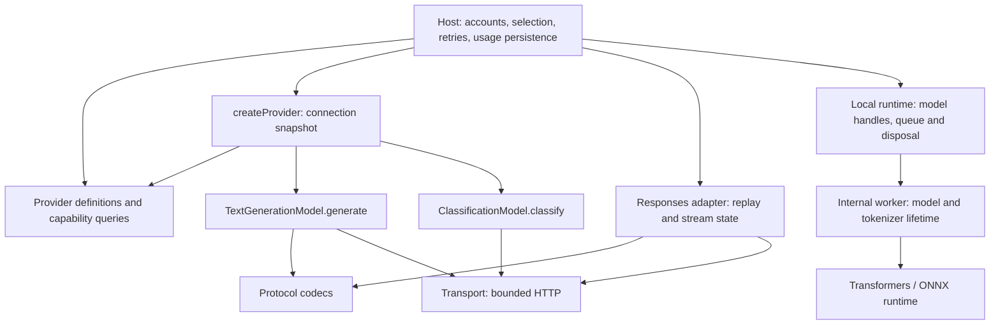

# @aipoch/providers

Provider definitions, capability-specific model instances, wire protocols and isolated local inference.
The host owns accounts, policy, persisted settings and process admission. The package owns provider/model
semantics, bounded requests, response validation, usage decoding and its internal runtime state.

## Public entry points

| Import                        | Responsibility                                                              | Runtime                                        |
| ----------------------------- | --------------------------------------------------------------------------- | ---------------------------------------------- |
| `@aipoch/providers`           | Immutable definitions and model queries by capability                       | Browser or Node                                |
| `@aipoch/providers/client`    | `createProvider`, text/classification models and connection-bound discovery | Node                                           |
| `@aipoch/providers/protocol`  | Protocol conversion, native namespace projection, Responses replay adapter  | Node                                           |
| `@aipoch/providers/local`     | Local model instances, queue and explicit disposal                          | Node                                           |
| `@aipoch/providers/errors`    | Failure classification and credential redaction                             | Browser or Node                                |
| `@aipoch/providers/transport` | URL security, redirect rejection and bounded response reads                 | URL helpers: browser or Node; body reads: Node |

Node 22.13+ is required. CommonJS `require`, ESM named imports and TypeScript declarations are supported.
Private source/build paths are not exported. The pre-release unbound clients are replaced by model instances;
there is no separate classification client entry or compatibility facade.

Ordinary consumers use `/client` for remote model calls and `/local` for local execution; the root entry
is optional metadata for model pickers. `/protocol` and `/transport` serve applications implementing
chat gateways and protocol bridges. They are not required to construct or invoke a model. Internal
vendor lookup helpers and unused endpoint builders are not public API.

## Provider and model management

Capabilities are named by the operation they provide: `textGenerationModel` and `classificationModel`.
`ModelCapability` currently contains only `text-generation` and `classification`. Future image/video
generation, speech synthesis or transcription can add their own invocation contracts when implemented;
no placeholder factories are exposed. Output payload fields such as `result.text` retain their meaning.

The design follows [LangChain's provider/model separation](https://github.com/langchain-ai/docs/blob/main/src/oss/concepts/providers-and-models.mdx)
and [AI SDK's capability-specific model factories](https://ai-sdk.dev/docs/ai-sdk-core/provider-management).
AI SDK also supports [decision models](https://ai-sdk.dev/docs/ai-sdk-core/decisions). These are architectural
references, not runtime dependencies: this package retains its existing classification `state/questions`
wire contract, cancellation behavior and usage semantics.

- A **provider definition** describes available capabilities, endpoints and bundled model suggestions.
  OpenRouter and OpenCode each have one definition containing both text-generation and classification capabilities.
- A **provider instance** snapshots the caller's credentials, selected endpoint and injected fetch.
  Create a new instance when configuration changes. There is no global account registry, environment-key
  lookup, automatic retry or default-model policy.
- A **model instance** binds `providerId`, `modelId` and `capability` to the appropriate invocation contract.
  Text generation uses `generate`; classification uses `classify`. Both return complete results without exposing HTTP response ownership.
  Credentials and endpoint objects are private, not mutable public state.

```ts
import { getProviderModels } from '@aipoch/providers'
import { createProvider } from '@aipoch/providers/client'

const textGenerationModels = getProviderModels('openrouter', 'text-generation')
const classificationModels = getProviderModels('openrouter', 'classification')
const provider = createProvider({
  id: 'openrouter',
  key: 'credential',
  fetch
})
const textGenerationModel = provider.textGenerationModel('provider/model-id')
await textGenerationModel.generate({
  systemPrompt: 'Translate faithfully.',
  prompt: 'Cell',
  signal: new AbortController().signal,
  maxOutputTokens: 1024,
  outputLimitBytes: 262144
})
const classifier = provider.classificationModel('typesafe/jev-1.13')
const result = await classifier.classify({
  state: 'Cell',
  questions: { relevant: { type: 'noul' } }
})
```

`getProviderModels` filters by capability and preserves region-specific text suggestions. It does not mix
classification models into chat choices. Bundled lists are not remote-model allowlists: new opaque model IDs
can be used immediately. `getProviderDefinition` returns the same capability definitions used by the factory.
Existing chat metadata helpers remain available for endpoint, context, vision and native reasoning queries.

Built-in providers resolve their region, model-specific protocol, endpoint and authentication inside the
package. The existing direct-call preference remains Chat, then Messages, then Responses when several
protocols are supported. `textGeneration` can override a base URL, declared protocols or an exact
`{ protocol, url }` for a custom service. Explicit configuration always wins. Empty declared protocols
remain unsupported. Model IDs are not restricted to bundled suggestions.

`generate({ prompt })` defaults to an empty system prompt, 4096 output tokens and a 1 MiB response limit.
Callers can pass cancellation, stricter limits and `onUsage`. The model rejects redirects and incomplete/tool
output and reports valid usage before answer rejection. Authentication follows the provider's dialect.
Full chat streaming/tool compatibility is a separate advanced `/protocol` integration.

Classification inputs accept optional prepared PNG `images` keyed by asset ID. The package encodes
image references, assets and protocol headers, chooses OpenRouter's image endpoint, and bounds the
UTF-8 image request body (16 MiB by default). An explicit endpoint overrides both text and image
routing; an empty image map keeps the original text protocol. The host owns image authorization,
loading, decoding, dimensions and PNG normalization, including cancellation and stale-setting checks.

Classification factories resolve built-in endpoints from the provider definition. Custom services supply
`classification: { url, maxResponseBytes?, maxRequestBytes? }`; the default response bound is 128 KiB.
`classify(input, { onUsage? })` returns validated answers, model, usage and `responseStatus` for diagnostics.
`ClassificationResponseError` identifies malformed or over-limit responses; `ClassificationHttpError`
retains the HTTP status and body for caller-owned error mapping. Redact response text before presentation.
No response streams or exchange handles are public. Valid billed usage is reported before answer/HTTP
rejection, including late cancellation. A caller explicitly scheduling a retry can set
`retryableErrors: 'discard'` to cancel a 429/529 body without waiting for it; a usage observer takes
precedence and always reads the bounded body. There are no implicit retries. Retry admission, budgets,
allowed labels, distribution policy, revision checks and usage persistence remain caller responsibilities.

Local Qwen appears in the same definition queries as a text model with `execution: 'local-worker'`. Its actual
execution remains through `/local` in a dedicated process; `createProvider().textGenerationModel()` requires a remote
endpoint and never silently starts a local runtime. The host retains installation, leases and process control.

## Responses lifecycle

```ts
import { createResponsesAdapter } from '@aipoch/providers/protocol'

const adapter = createResponsesAdapter({ reasoningCacheMaxEntries: 4096 })
const turn = adapter.prepare({
  scope: 'authorized-conversation-id',
  body: { model: 'model', input: 'Hello', stream: false }
})
const upstream = await fetch('https://gateway.example/v1/chat/completions', {
  method: 'POST',
  headers: { 'content-type': 'application/json' },
  body: JSON.stringify(turn.request)
})
const response = await turn.convert(upstream)
// Consume response.json() or response.body. A turn can be converted once.
adapter.clear() // Retargeting invalidates replay, including late writes from earlier turns.
adapter.dispose() // Final shutdown also cancels active readers; future prepare calls fail.
```

The adapter is the sole owner of replay identities, grouping, LRU bounds and reconciliation. Give each
independent upstream/credential lifetime its own instance. A missing scope disables replay. The host must
validate/authorize the opaque scope and tool list before preparation; supplying a scope grants no permission.
`tools` describes trusted namespace mappings. Application-specific tool filtering belongs to the host.
`convertResponsesRequest` provides stateless conversion for probes.

Cancel the returned stream when abandoning it. Reads are bounded and demand-driven. Default response limit:
64 MiB; each SSE event and line: 8 MiB. Streaming conversion owns delta assembly and emits one terminal event;
JSON conversion owns completed-response projection. All state is memory-only and is never serialized.

## Internal ownership

```text
providers/   immutable provider definitions, capability queries, connection/model construction
runtimes/    local worker communication, queue, model handles and confirmed disposal
models/      common identity, bound text and classification invocation contracts and implementations
protocols/   endpoint/reasoning/usage rules, text codecs and vendor compatibility
transport/   HTTP security, bounded bytes and SSE framing
responses/   conversion, stream assembly, replay and adapter lifecycle
discovery/   bounded live model-list requests
resources/   isolated local runtime, tokenizer/model lifecycle and JSONL worker
errors.ts    browser-safe diagnostics
```



Definition modules reference model identity **types** only. Runtime provider construction depends on model
implementations; models depend on protocols/transport and never import provider definitions or host source.
The root metadata entry does not load runtime clients or ONNX. Internal dependency/cycle guards and the
installed browser-entry bundle verify these boundaries. Credentials are per instance; HTTP response ownership
is per call. The replay adapter and local model worker retain their separate explicit lifetimes.

Application model defaults, discovery compatibility, reasoning preference slots, account eligibility,
persisted target hashes, permissions and HTTP/session lifecycle remain in the host.

## Model discovery

`provider.listModels()` fetches the live inventory using the same connection's credentials, region and
fetch implementation. `provider.supportsModelDiscovery` indicates whether an endpoint is configured.
Built-in endpoint resolution stays inside the package; custom services use `discovery: { url }`.
The factory snapshots that URL, so later mutations of the configuration cannot retarget a connection.

```ts
const provider = createProvider({ id: 'deepseek', key: 'credential' })
const abortController = new AbortController()
const inventory = await provider.listModels({ timeoutMs: 15_000, signal: abortController.signal })
```

Per-call bounds (`limits.modelListResponseBytes`, `limits.fetchedModels`, `limits.modelIdCharacters`)
default to 2 MiB / 2000 models / 512 characters. Positive safe-integer limits are validated before
sending; explicit `undefined` keeps the default. Timeouts must fit Node timers (1–2147483647 ms).
Caller cancellation and the timeout cover both fetching and reading the response stream; injected fetch
implementations must honor the supplied signal. Failures, including cancellation, return `ok: false`; unused HTTP error bodies
are cancelled. Discovery does not update accounts, choose defaults, cache results or filter product-specific
choices. For example, xAI's inventory includes non-chat models; a host chat picker owns its curated-list
policy and OAuth filtering. The low-level URL/request function is internal.

## Build and verify

In a standalone source checkout, install the declared `@aipoch/diagnostics` sibling release (or its tarball),
then run `npm install`, `npm run build`, `npm run typecheck`, `npm test`, and `npm pack`. Local inference tests
also use the declared Transformers/ONNX development dependencies; no model weights need downloading.
Vitest owns concurrency. Tests use independent inputs and ephemeral ports.

The monorepo `npm run check:providers-package` installs clean source copies using only declared dependencies,
builds/typechecks/tests, packs real tarballs, and installs them into a clean consumer. After deleting source
copies and pruning dev dependencies it checks CJS/ESM identities, public types, private-path rejection,
browser-safe definitions, text/classification execution, replay lifetime and installed local WASM resources.
Upstream builds do not rerun upstream tests. See [test ownership](test-ownership.md) for assertion mapping.

## Concrete wire compatibility

`/protocol` includes xAI request sanitization, Anthropic/Chat-to-Responses projections and reverse
completed-response projections. The cached JS token estimator owns one read-only vocabulary; it has no
native handle or mutable account state. `prepareNativeResponsesRequest(body)` returns the flattened
request, `resolveTool(name)`, `toolCount` and a bound `restore(payload)` decoder. The alias map is private
to that request. Callers authorize tools before conversion and retain application-specific MCP policy.

## Local text generation

`@aipoch/providers/local` exports `createLocalTextRuntime`. It starts a dedicated Node worker lazily;
importing this entry or using remote clients does not load ONNX. No worker path or wire protocol is public.

```ts
import { createLocalTextRuntime } from '@aipoch/providers/local'

const runtime = createLocalTextRuntime()
try {
  const model = runtime.createModel({ directory: '/approved/qwen3-0.6b-q8' })
  const result = await model.generate({ prompt: 'Translate Cell into Chinese.' })
  await model.dispose()
} finally {
  await runtime.dispose()
}
```

Install the optional peers `@huggingface/transformers@4.2.0` and
`onnxruntime-web@1.26.0-dev.20260416-b7804b056c` when using local inference. The caller supplies an absolute
approved directory containing the pinned Qwen tokenizer/model assets; no weights are packed or downloaded.
`QWEN3_LOCAL_TEXT_GENERATION_MODEL` describes the required revision and asset manifest. Runtime WASM
resources load from installed dependencies independently of the repository and cwd.

One runtime owns one worker and a queue shared by its model handles. Different directories cause a worker
restart; active inference drains before a handle's disposal resolves. The last handle for the loaded
directory stops its worker before disposal completes, even if handles for other directories remain. Cancellation and timeout terminate
inference. Disposal rejects on unconfirmed process termination and may be retried; the application must
retain file leases until disposal succeeds. `dispose()` on the runtime cancels active work, drains the
queue and prevents new models. Bounds remain 4096 input tokens, 2048 generated tokens, 64 KiB prompt
text and a maximum 1 MiB output. The default inference timeout is 180 seconds.

Ordinary Node consumers need no process hooks. A failed spawn preserves its original error; disposal
does not wait for an exit from a process that never started. Applications with managed process supervision can supply
`process: { launch(workerPath), terminate(child) }`; launch must return a child with piped stdio, and
terminate must resolve only after confirmed exit. This is where the host supplies its Node environment,
process-tree registration and platform shutdown behavior. The package owns framing, parsing, queues and
inference lifecycle. The host owns installation, approved directories, leases and app-wide admission.
PDF table extraction remains in `@aipoch/pdf-structure`; no persisted receipts or paths migrate.

`npm test` includes real CPU WASM inference using a tiny generated ONNX identity model; it downloads no
weights. `npm run check:providers-package` from the repository additionally checks installed worker
resources after deleting build-source copies and pruning consumer development dependencies. That
check exercises both default Node process launch/disposal and the optional managed-process hooks.

For full-model acceptance, prepare the pinned assets in an approved directory and run
`npm run check:providers-package -- --local-model-dir /absolute/path/to/model`.
This opt-in check performs real Qwen generation, cancellation, recovery and disposal through the
installed tarball's default Node runtime, after removing build sources and pruning development
dependencies. It downloads no weights and requires enough memory for the 0.6B quantized model.
The separate host `e2e/pdf-translation-local.spec.ts` uses `OPEN_SCIENCE_PDF_LOCAL_MODEL_DIR` to verify
Electron installation, translation, cancellation, checkpoint recovery, restart and removal.
